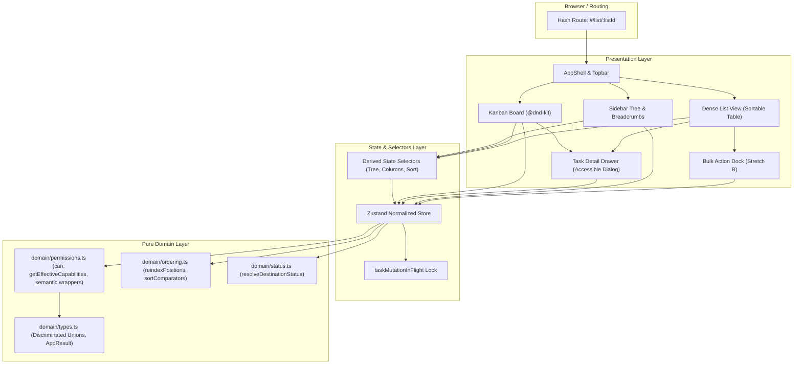

# Flowboard

> A mini project-management web application for modern product and engineering teams (ClickUp / Asana / Linear at hobby scale).

---

## Overview

Flowboard is a planned frontend-only project management application designed with production-grade engineering principles. It features a strict container hierarchy, list-scoped status workflows, dual-view task management (Kanban Board and Dense List View), an accessible Task Detail Drawer, and a robust client-side authorization model with instant multi-user simulation.

This repository contains the comprehensive engineering architecture, testing strategy, and implementation plan, structured for strictly sequential, test-driven execution.

---

## Planning & Architecture Documents

The project is thoroughly documented across five structured engineering specifications:

| Document | Purpose |
|---|---|
| [**00 — Initial Analysis**](docs/00-INITIAL-ANALYSIS.md) | Assignment coverage assessment, design trade-offs, architecture readiness, and risk analysis |
| [**01 — Requirements Catalogue**](docs/01-REQUIREMENTS.md) | Exhaustive requirement mapping across Hierarchy, Tasks, Statuses, Views, Permissions, UX, A11y, and Stretch Goals |
| [**02 — Architecture**](docs/02-ARCHITECTURE.md) | Normalized Zustand state design, pure domain rules, component hierarchy, transaction mechanics, and design tokens |
| [**03 — Testing Strategy**](docs/03-TESTING-STRATEGY.md) | Risk-focused test approach, permission & store test matrix, RTL component test specs, and manual QA protocol |
| [**04 — Implementation Plan**](docs/04-IMPLEMENTATION-PLAN.md) | 5 phases, 7 reviewable batches, 15 structured tasks with explicit acceptance criteria and MVP Gate |

---

## Architecture Direction

### System Architecture Diagram



### Core Architecture Principles

1. **Normalized Single Source of Truth**:
   - Entities (`containersById`, `tasksById`, `statusesById`, `usersById`, `grants`) are stored in normalized maps inside a typed Zustand store.
   - Kanban Board and Dense List views consume projections derived from this single source of truth, guaranteeing zero state drift between views.
2. **Capability-Based Authorization & Domain Layer**:
   - Authorization is governed by explicit capabilities (`container.*`, `task.*`, `permission.bypass`) rather than hardcoded role names (`user.role === 'admin'`).
   - Role configuration (`getEffectiveCapabilities`) supports role inheritance (Admin inherits Member), allowing future roles (Viewer, Manager) to be introduced via configuration without policy rewrites.
   - Pure policy engine (`can()`) enforces a deterministic precedence model: archive check strictly precedes bypass; bypass skips normal grants; grants inherit hierarchically where DENY strictly wins over ALLOW.
   - Store mutations enforce permissions directly, returning typed `AppResult<T>` errors (`FORBIDDEN`) when unauthorized mutations are attempted.
3. **Route as Truth for Active Context**:
   - The active list is read directly from the hash fragment (`#/list/:listId`), eliminating dual-state synchronization bugs between routing and store.
4. **Deterministic Mutations & Invariant Protection**:
   - Contiguous sibling ordering (`0..n-1`) is guaranteed via `reindexPositions()` on every position-affecting operation.
   - Cross-list task moves safely remap statuses using category matching (`resolveDestinationStatus`).
   - A `taskMutationInFlight` concurrency lock guards all task mutations against overlapping or race conditions.
5. **Strict Design Token Fidelity**:
   - The UI adheres strictly to Tailwind CSS extended with `fb-*` design tokens extracted from static Figma materials (colors, typography, radii, shadows). Zero ad-hoc custom CSS files are used.
6. **Persistence Choice & Refresh Invariants**:
   - **Persistence choice**: Flowboard intentionally keeps canonical domain data in memory and restores deterministic fixtures on reload. The assignment permits optional localStorage persistence, but we chose not to persist the mock domain store to avoid stale or schema-sensitive evaluator state. Only the active user perspective is retained in `sessionStorage` (`flowboard.activeUserId`) so refreshes preserve permission context, while the active List remains URL-driven via `#/list/:listId`.
   - **Deterministic Refresh Behavior**:
     - *Bob + Backlog* → refresh ⇒ Bob + Backlog
     - *Carol + Marketing (`list-growth`)* → refresh ⇒ Carol + Marketing
     - *Alice + Sprint 18* → refresh ⇒ Alice + Sprint 18
     - *Bob + forbidden Sprint 18 (`#/list/list-sprint-18`)* → refresh ⇒ Bob remains Bob and 403 Restricted Card remains visible (never resets to Alice or redirects).
   - **Multi-Tab Evaluation**: Because `sessionStorage` is scoped per tab, evaluators can open multiple tabs side-by-side (e.g., Tab 1 as Alice Admin, Tab 2 as Bob Member) to compare trees and permissions simultaneously without cross-tab session collision.

---

## Data Model & Hierarchy

The container tree follows a **strict 4-tier hierarchy**:

```
Workspace (Flowboard Workspace)
└── Space (Engineering, Marketing)
    └── Folder (Q2 Launch, Campaigns)
        └── List (Backlog, Sprint 18, Growth Campaigns)
            └── Tasks (FE-101, FE-102, ...)
```

- **Lists Own Status Sets**: Every list defines its own discrete set of statuses (minimum 3: `todo`, `in_progress`, `done`). A task's `statusId` must strictly belong to its primary list's status set.
- **Grants & Visibility**:
  - Public containers are visible to all members unless explicitly denied.
  - Private containers are invisible unless an explicit `allow` grant exists on the container or inherited from an ancestor (`permission.bypass` skips normal grant checks).
  - Ancestor ALLOW propagates down the subtree; ancestor DENY blocks the entire subtree (DENY strictly wins over ALLOW).
  - Archived containers and subtrees are unconditionally hidden from all users, even those with `permission.bypass`.
  - Structural tree pruning hides descendant nodes if any ancestor is inaccessible or archived.

---

## MVP vs. Stretch Distinction

To ensure delivery of a robust, production-quality core application, work is structured into an **MVP Core** followed by an **MVP Release Gate**, with stretch goals isolated to an elective phase.

### MVP Scope (Batches 1–5, Tasks T01–T12)
- Strict 4-tier container tree with collapsible sidebar and admin container management (create, rename, archive, reorder).
- Task management: create, edit, delete, cross-list move, and status changes.
- Kanban Board with multi-column status layout and basic drag-and-drop (`@dnd-kit`).
- Dense List View with deterministic sorting by due date and priority.
- Accessible Task Detail Drawer with Create and Edit modes, controlled draft state, and dirty-close confirmation.
- 3 mock users (Alice: admin, Bob: member, Carol: member) with instant switcher and 403 Restricted Card on forbidden routes.
- Tailwind design tokens, responsive layout (desktop fixed, mobile off-canvas drawer), loading skeletons, and empty states.
- Basic Kanban DnD is a core MVP requirement, NOT a stretch goal.

### Selected Stretch Goals (Batch 6, Tasks T13–T14)
Per the assignment guidance (*"Pick at most two if MVP is solid"*), exactly two elective engineering stretch goals are implemented:

1. **Stretch A — Optimistic Kanban DnD with Scoped Rollback**:
   - Immediate visual drop feedback before background commit.
   - Pre-mutation transaction snapshot (`TaskMoveTransactionSnapshot`) capturing only affected column slices.
   - Topbar "Simulate Failure" toggle to deterministically test rollback behavior.
   - Rollback strictly restores affected fields (`statusId`, `position`, `updatedAt`, sibling positions) without clobbering unrelated task attributes.
2. **Stretch B — Bulk Update (Dense List Multi-Select)**:
   - Checkbox selection on Dense List rows with indeterminate header checkbox and "Select All Visible".
   - Floating action dock for atomic status change and additive assignee assignment.
   - All-or-nothing preflight validation ensuring zero partial state mutation on failure.

### Explicitly Excluded / Cut Scope
- Client-side full-text search engine (visual search bar retained in UI).
- Dynamic audit logging / live activity feed (read-only static activity specimens retained).
- Dark mode and mobile redesign (desktop-first with responsive adaptation).
- Container DnD reordering (button-based reorder satisfies assignment).

---

## Testing Strategy

Testing is focused on high-risk business logic where defects would silently corrupt permissions or state. Mandatory tests are implemented alongside the functionality they verify, well ahead of the MVP Gate:

1. **Domain & Store Permission Tests (Vitest — Implemented in T05)**:
   - Alice admin bypass across all non-archived containers.
   - Bob member restrictions (Sprint 18 explicit deny, Marketing private subtree exclusion).
   - Carol member grants (private Marketing subtree access).
   - Archived containers and ancestors hidden from all users.
   - Unauthorized container CRUD and task mutations returning `FORBIDDEN`.
   - Concurrency lock protection preventing user switching during active mutations.
2. **Component Testing (React Testing Library — Implemented in T10)**:
   - Focused integration test on `TaskDrawer`: Create vs. Edit initialization, dirty state tracking on field changes, and discard confirmation on `requestClose()`.
3. **Stretch State-Integrity Tests (Required — Implemented in T13 & T14)**:
   - Optimistic DnD rollback integrity test (`optimisticDnD.test.ts`).
   - Bulk update all-or-nothing atomicity test (`bulkUpdate.test.ts`).
4. **Architectural Trade-Off**:
   - We deliberately chose RTL component testing over external E2E tools (Playwright/Cypress) to prioritize deterministic CI execution, instant feedback loops, and zero test flakiness at this project scale.
5. **Manual QA Protocols**:
   - Documented test matrices covering user switching, DnD gestures (pointer and touch delay), responsive viewport scaling (375px to 1440px), focus management, and failure simulations.

---

## Implementation Approach

Implementation proceeds through 15 sequential tasks organized into 7 reviewable batches:

```
Batch 1: Foundation (T01: Scaffold + Tokens, T02: Domain Types + Rules, T03: Fixtures)
Batch 2: State Layer (T04: Canonical Store + Containers, T05: Tasks + Selectors + Permission Tests)
Batch 3: App Shell (T06: AppShell + Routing, T07: Sidebar + Access Guards)
Batch 4: Views & Drawer (T08: Kanban Board, T09: Dense List, T10: Task Drawer + Component Test)
Batch 5: DnD & Polish (T11: Basic Kanban DnD, T12: UX States + Responsive + A11y)
============================= >>> MVP GATE <<< =============================
Batch 6: Stretch Goals (T13: Optimistic DnD Rollback + Test, T14: Bulk Update Dock + Test)
Batch 7: Finalization (T15: Full Regression Suite + Production Build Gate)
```

Each step adheres strictly to the workflow:
`IMPLEMENT → VERIFY → RUN CHECKS → REPORT → SUGGEST COMMIT → STOP`

---

## Getting Started

### Prerequisites
- Node.js (v18.0.0 or higher recommended)
- npm (v9.0.0 or higher)

### Installation & Local Development

```bash
# Install dependencies
npm install

# Start local development server
npm run dev
```

The application will be available at `http://localhost:5173`.

### Quality & Release Verification

```bash
# Run TypeScript typecheck
npm run typecheck # or: tsc --noEmit

# Run automated tests
npm test

# Build production bundle
npm run build
```
