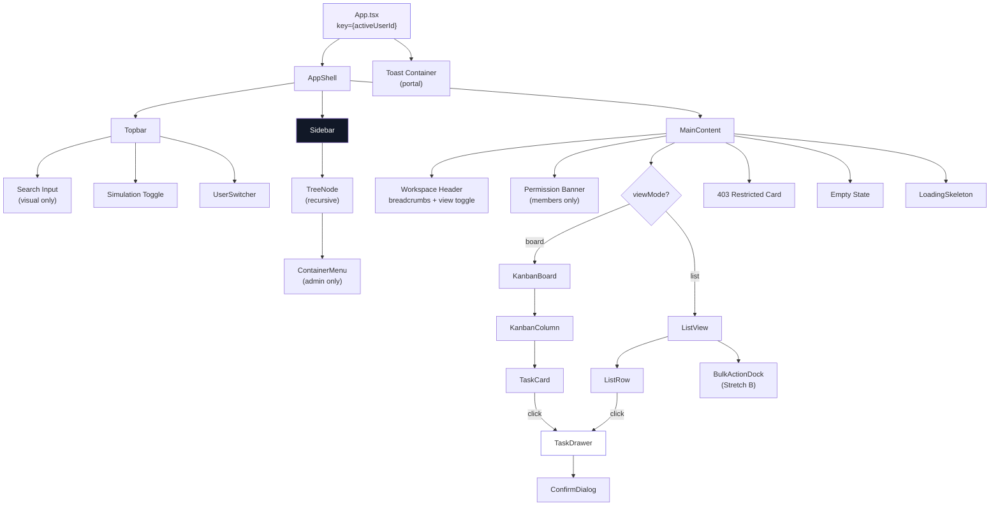

# Flowboard — Architecture

> **Stack**: React 18 + TypeScript (strict) + Vite + Zustand + Tailwind CSS + @dnd-kit
> **Architecture**: Feature-oriented React + pragmatic MVC + pure domain rules + normalized Zustand store

---

## 1. Why This Architecture

The goal is the strongest practical production frontend solution for a client-only project management app with ~15-50 tasks, 3 mock users, and no backend.

**Core constraints shape the architecture**:
- No server → no async data fetching → no React Query / SWR / loading orchestration
- Single workspace, single tenant → no multi-tenant routing complexity
- ~50 entities max → no virtualization needed
- Tailwind-only styling → no CSS modules, no styled-components
- Store-level permission enforcement → domain rules must be independent of React

**Result**: Pure domain functions (zero dependencies) + Zustand normalized store (canonical state + guarded mutations) + React components (views) + React hooks (controllers/orchestration) + hash routing (single source of truth for active list).

This avoids: fake service layers, repository abstractions, CQRS, event buses, DI frameworks, and ceremonial Controller classes.

---

## 2. Source Structure

```
src/
├── domain/                         # Pure TypeScript — ZERO React/Zustand deps
│   ├── types.ts                    # Domain types, RoleDefinition, Capability, AppResult
│   ├── permissions.ts              # can(), getEffectiveCapabilities(), semantic wrappers
│   ├── ordering.ts                 # reindexPositions (0..n-1), sorting comparators
│   ├── task-movement.ts            # resolveDestinationStatus, computeTaskMove
│   └── constants.ts                # STATUS_COLOR_STYLES, PRIORITY_ORDER, VALID_PARENT_TYPES
│
├── store/                          # Zustand canonical store
│   ├── store.ts                    # Store definition + all mutations (guarded commands)
│   ├── selectors.ts                # Derived state: filtered tree, kanban columns, sorted list
│   └── fixtures.ts                 # Seed data + activityByTaskId map
│
├── hooks/                          # React hooks (controller layer)
│   ├── useActiveList.ts            # Reads listId from hash route (source of truth)
│   ├── useDrawer.ts                # Drawer open/close/mode + draft state management
│   ├── useSimulatedLoad.ts         # Skeleton loading delay (configurable, 0 in tests)
│   ├── useBulkSelection.ts         # selectedTaskIds Set + select/deselect/clear/selectAll
│   ├── useToast.ts                 # Toast notification state + auto-dismiss
│   └── useRouteGuard.ts            # Access validation + redirect on user switch / archive
│
├── components/                     # React components (view layer)
│   ├── app/
│   │   ├── App.tsx                 # Root: AppShell + route parsing + key={activeUserId}
│   │   ├── AppShell.tsx            # Layout: Topbar + Sidebar + Main content area
│   │   └── Topbar.tsx              # Branding, search, simulation toggle, user switcher
│   │
│   ├── sidebar/
│   │   ├── Sidebar.tsx             # Sidebar container (desktop fixed / mobile off-canvas)
│   │   ├── TreeNode.tsx            # Recursive tree node (space/folder/list)
│   │   └── ContainerMenu.tsx       # Context menu: create child, rename, archive, move up/down
│   │
│   ├── board/
│   │   ├── KanbanBoard.tsx         # Board container: maps statuses → columns
│   │   ├── KanbanColumn.tsx        # Single status column with header + cards
│   │   └── TaskCard.tsx            # Card: title, priority, assignees, due date
│   │
│   ├── list/
│   │   ├── ListView.tsx            # Dense table container + sorting state
│   │   ├── ListRow.tsx             # Table row: title, status pill, assignees, priority, due
│   │   └── BulkActionDock.tsx      # Floating bottom dock (Stretch B)
│   │
│   ├── drawer/
│   │   ├── TaskDrawer.tsx          # Accessible dialog: Create/Edit modes + draft + activity
│   │   └── ConfirmDialog.tsx       # Reusable discard/delete confirmation modal
│   │
│   └── shared/
│       ├── StatusPill.tsx          # Status badge with color from STATUS_COLOR_STYLES
│       ├── PriorityBadge.tsx       # Priority indicator with icon + color
│       ├── Avatar.tsx              # User avatar (initials-based)
│       ├── Toast.tsx               # Error/success toast notification
│       ├── EmptyState.tsx          # "No tasks here yet" illustration
│       ├── LoadingSkeleton.tsx     # Shimmer skeleton for board/list/tree
│       └── RestrictedCard.tsx      # 403 Forbidden card (Node 1:882)
│
├── index.css                       # Tailwind directives ONLY (@tailwind base/components/utilities)
└── main.tsx                        # ReactDOM.createRoot entry point
```

### Module Boundaries

| Layer | Responsibility | May Import | Must NOT Import |
|---|---|---|---|
| `domain/` | Types, pure business rules, constants | Nothing (zero deps) | React, Zustand, components |
| `store/` | Canonical state, guarded mutations, selectors | `domain/` | React, components, hooks |
| `hooks/` | Orchestration, transient UI state, route parsing | `domain/`, `store/` | Components |
| `components/` | Rendering, user interaction, local UI state | `domain/`, `store/`, `hooks/`, `components/` | Direct store mutations (use hooks) |

---

## 3. Domain Layer (`domain/`)

Pure TypeScript functions with zero React or Zustand dependencies. Independently testable.

### 3.1 Types (`domain/types.ts`)

All domain entities required by the data model and assignment requirements:

- `ContainerType`, `ContainerNode` — hierarchy nodes
- `TaskPriority`, `Task` — task entities
- `StatusCategory`, `StatusColor`, `TaskStatus` — list-scoped statuses
- `UserRole`, `User` — mock users
- `GrantMode`, `Grant` — permission grants
- `Capability` — explicit fine-grained capability union
- `RoleDefinition` — configurable role data structure with inheritance
- `StaticActivityEntry` — seeded read-only activity (with `userId` and `relativeTime` per Decision 1)
- `AppErrorCode`, `AppResult<T>` — typed error/result contract

### 3.2 Permissions (`domain/permissions.ts`)

Pure authorization engine built around:
1. **Capability-based RBAC**: Actions are governed by explicit capabilities, not hardcoded role names.
2. **Role Inheritance**: Roles configure capabilities and can inherit from other roles.
3. **Hierarchical Resource & Grant Inheritance**: Grants propagate down the container hierarchy (`Workspace → Space → Folder → List → Task`).
4. **Deterministic Precedence**: Archive check strictly precedes bypass; bypass skips normal grants; grants and privacy evaluated along the hierarchy path; DENY strictly wins over ALLOW.

#### 3.2.1 Capabilities & Role Configuration

```typescript
export type Capability =
  | 'container.read'
  | 'container.create'
  | 'container.rename'
  | 'container.archive'
  | 'container.reorder'
  | 'task.read'
  | 'task.create'
  | 'task.update'
  | 'task.delete'
  | 'task.move'
  | 'permission.bypass';

export interface RoleDefinition {
  id: string;
  name: string;
  inherits?: string[];
  capabilities: Capability[];
}
```

#### 3.2.1 Capabilities, Role Configuration & Frontend Source

In Flowboard's frontend-only architecture:
- **`DEFAULT_ROLES`** (`domain/constants.ts`) defines **WHAT** each role can do (capability assignment & role inheritance).
- **`usersById`** (`store/fixtures.ts`) defines **WHICH** role each user has:
  - `user-alice` → `admin`
  - `user-bob` → `member`
  - `user-carol` → `member`
- **`grants`** (`store/fixtures.ts`) defines resource-level allow/deny overrides.

*Note: In production with a backend, identity and role assignment would originate from session/JWT tokens; here, fixture state acts as the simulated authoritative backend. Permission business logic never hardcodes specific user IDs.*

```typescript
export type Capability =
  | 'container.read'
  | 'container.create'
  | 'container.rename'
  | 'container.archive'
  | 'container.reorder'
  | 'task.read'
  | 'task.create'
  | 'task.update'
  | 'task.delete'
  | 'task.move'
  | 'permission.bypass';

export interface RoleDefinition {
  id: string;
  name: string;
  inherits?: string[];
  capabilities: Capability[];
}

export interface PermissionContext {
  containersById: Record<string, ContainerNode>;
  grants: Grant[];
  usersById: Record<string, User>;
  roleDefinitions?: Record<string, RoleDefinition>;
}
```

Configured roles in Flowboard:
- **`member`**: `['container.read', 'task.read', 'task.create', 'task.update', 'task.delete', 'task.move']`
- **`admin`**: inherits `member`, plus `['container.create', 'container.rename', 'container.archive', 'container.reorder', 'permission.bypass']`

`getEffectiveCapabilities(roleId, roleDefinitions)` traverses the role inheritance graph, deduplicates capabilities, safely handles missing roles, and guards against cycles.

#### 3.2.2 Generic Policy Engine: `can()`

```typescript
export function can(
  userId: string,
  capability: Capability,
  resourceId: string,
  context: PermissionContext
): boolean
```

**Deterministic Evaluation Precedence & Tree Integrity:**
1. **Tree Integrity Safeguards (Fail Closed)**:
   - Hierarchy cycles fail closed (`false`).
   - Broken ancestry chains (missing parent node) fail closed (`false`).
2. **Archive Check**: If target or any ancestor in the path is archived (`archived: true`), access is immediately DENIED (`false`). Applies unconditionally, even with `permission.bypass`.
3. **Effective Role Capabilities**: Resolve capabilities via role inheritance. If user lacks capability → DENIED (`false`).
4. **Bypass**: Possesses `permission.bypass` → GRANTED (`true`) on non-archived resources without grant checks.
5. **Hierarchical Grants**: Ancestor or direct `deny` blocks target and subtree (DENY strictly wins over ALLOW).
6. **Private / Public Visibility**: Private requires direct or inherited `allow`; public allowed unless denied; structural accessibility maintained.

#### 3.2.3 Semantic Task & Container Wrappers

Semantic helper functions accept a lightweight `PermissionContext` object and delegate to `can()`:

**Task Generic Helper**:
```typescript
canTask(userId, task, capability, context)
  → can(userId, capability, task.primaryListId, context)
```

**Delegating Semantic Wrappers**:
- `canViewNode(userId, containerId, context)` → `can(userId, 'container.read', containerId, context)`
- `canCreateTask(userId, listId, context)` → `can(userId, 'task.create', listId, context)`
- `canEditTask(userId, task, context)` → `canTask(userId, task, 'task.update', context)`
- `canDeleteTask(userId, task, context)` → `canTask(userId, task, 'task.delete', context)`
- `canMoveTask(userId, task, destinationListId, context)` → `canTask(userId, task, 'task.move', context) && can(userId, 'task.move', destinationListId, context)`
- `canCreateContainer(userId, parentId, context)` → `can(userId, 'container.create', parentId, context)`
- `canRenameContainer(userId, containerId, context)` → `can(userId, 'container.rename', containerId, context)`
- `canArchiveContainer(userId, containerId, context)` → `can(userId, 'container.archive', containerId, context)`
- `canReorderContainer(userId, containerId, context)` → `can(userId, 'container.reorder', containerId, context)`

#### 3.2.4 Current Role Capability Matrix

| Capability | Admin | Member | Notes |
|---|---|---|---|
| View accessible containers (`container.read`) | Yes | Yes | Evaluated hierarchically |
| View public resources | Yes | Yes unless denied | Public default |
| View private resources | Yes | Only with inherited/direct allow | Private default |
| Bypass normal grants (`permission.bypass`) | Yes | No | Still blocked by archived containers |
| View archived resources | No | No | Unconditional DENY |
| Read tasks (`task.read`) | Yes | Yes on accessible lists | Inherited from primaryListId |
| Create tasks (`task.create`) | Yes | Yes on accessible lists | Inherited from primaryListId |
| Update tasks (`task.update`) | Yes | Yes on accessible lists | Inherited from primaryListId |
| Delete tasks (`task.delete`) | Yes | Yes on accessible lists | Inherited from primaryListId |
| Move tasks (`task.move`) | Yes | Yes when both lists accessible | Symmetrically checked on source & dest |
| Create containers (`container.create`) | Yes | No | Container management |
| Rename containers (`container.rename`) | Yes | No | Container management |
| Archive containers (`container.archive`) | Yes | No | Container management |
| Reorder containers (`container.reorder`) | Yes | No | Container management |

*Note: This matrix describes CURRENT role configuration in Flowboard fixtures, not hardcoded business logic. Future roles such as `viewer` (with `container.read` and `task.read` only) or `manager` can be added via role configuration with zero changes to policy engine logic.*

### 3.3 Ordering (`domain/ordering.ts`)

**`reindexPositions<T extends { position: number }>(items: T[]): T[]`**
- Assigns contiguous positions `0, 1, 2, ... n-1` to items in their current array order
- Used after every position-affecting operation: reorder, move, delete, bulk update

**Sorting comparators for Dense List View:**
- Priority: `urgent > high > normal > low > none`
- Due date ascending: earliest first, `null` last
- Stable tie-breaker: `position` then `id`

### 3.4 Task Movement (`domain/task-movement.ts`)

**`resolveDestinationStatus(sourceStatus, destListId, statuses): TaskStatus`**
1. Find destination statuses with matching `category`
2. Sort by `position`, take first
3. If no match, use destination list's lowest-position status

**`computeTaskMove(...)` — deterministic cross-list movement logic**
- Returns the new `statusId`, validated destination, and position data
- Pure computation; store applies the result

### 3.5 Constants (`domain/constants.ts`)

```typescript
export const STATUS_COLOR_STYLES: Record<StatusColor, { dot: string; pill: string; text: string }>;
export const PRIORITY_ORDER: Record<TaskPriority, number>;
export const VALID_PARENT_TYPES: Record<Exclude<ContainerType, 'workspace'>, ContainerType>;
```

Static Tailwind class maps. No runtime hex. No dynamic class generation.

---

## 4. State Management

### 4.1 State Ownership Taxonomy

```
┌─────────────────────────────────────────────────────────────┐
│                    ZUSTAND STORE                            │
│                                                             │
│  Canonical State          │  Session State                  │
│  ─────────────            │  ─────────────                  │
│  containersById           │  activeUserId                   │
│  tasksById                │  viewMode ('board' | 'list')    │
│  statusesById             │  simulateFailureNext            │
│  usersById                │  taskMutationInFlight           │
│  grants                   │                                 │
│  nextTaskNumber           │                                 │
│  activityByTaskId         │                                 │
│                           │                                 │
│  Guarded Mutations (AppResult<T>)                           │
│  ─────────────────────────────                              │
│  createContainer, renameContainer, archiveContainer,        │
│  moveContainerUp/Down, createTask, updateTask, deleteTask,  │
│  moveTaskToList, moveTaskStatus, reorderTask,               │
│  setActiveUser, bulkUpdateTasks, resetData                  │
└─────────────────────────────────────────────────────────────┘

┌─────────────────────────────────────────────────────────────┐
│              DERIVED STATE (Selectors)                      │
│              ──────────────────────                         │
│  getFilteredTree(userId) → ContainerNode[]                  │
│  getKanbanColumns(listId, userId) → KanbanColumn[]          │
│  getSortedTasks(listId, sortKey, sortDir) → Task[]          │
│  getListStatuses(listId) → TaskStatus[]                     │
│  getBreadcrumbs(listId) → ContainerNode[]                   │
│  getTaskCount(listId) → number                              │
│  getVisibleLists(userId) → ContainerNode[]                  │
└─────────────────────────────────────────────────────────────┘

┌─────────────────────────────────────────────────────────────┐
│          TRANSIENT UI STATE (React local)                   │
│          ───────────────────────                            │
│  Drawer: draft form data, isDirty, mode                     │
│  Bulk: selectedTaskIds Set                                  │
│  Sidebar: expanded/collapsed node IDs                       │
│  DnD: active drag item, drag-over target (@dnd-kit)         │
│  Toast: message queue + auto-dismiss                        │
│  Skeleton: simulated loading state                          │
│  Mobile sidebar: off-canvas open/close                      │
└─────────────────────────────────────────────────────────────┘
```

### 4.2 Key Design Decisions

**Decision: Normalized store, not nested tree**
- Why: O(1) entity lookups by ID; mutations don't require deep tree traversal; selectors compose entities into views
- Trade-off: Tree shape must be computed by selectors from flat `containersById`
- Alternative rejected: Nested tree structure (mutations require deep cloning, harder to update individual nodes)

**Decision: Route as source of truth for active list**
- Why: `#/list/:listId` prevents duplicated `activeListId` in store; browser back/forward works; deep linking works
- Trade-off: Must parse hash on every render (trivial cost)
- Alternative rejected: `activeListId` in Zustand (two sources of truth for same data)

**Decision: `key={activeUserId}` on content container**
- Why: Cleanly resets all transient UI state (drawer drafts, bulk selection, sidebar expansion) on user switch
- Trade-off: Brief re-mount; acceptable for 3-user switching scenario
- Note: Does NOT replace explicit route reconciliation — user switch to an inaccessible list auto-reconciles to the first accessible list, while direct forbidden access preserves the URL and renders 403

**Decision: Single `taskMutationInFlight` boolean lock**
- Why: Prevents concurrent mutations from corrupting position state (especially during ~300ms optimistic rollback delay)
- Trade-off: Blocks ALL task mutations during lock, even unrelated ones; acceptable for single-user local-only store
- Alternative rejected: Per-task locks (overengineered for in-memory synchronous store)

**Decision: `AppResult<T>` discriminated union for all fallible mutations**
- Why: Forces callers to handle errors; no thrown exceptions to catch; TypeScript narrows `data` vs `error`
- Trade-off: Slightly more verbose call sites
- Alternative rejected: Thrown errors (easy to forget `try/catch`, lose type safety)

**Decision: In-memory canonical domain store + sessionStorage for active user identity**
- Why: The assignment states *"There is no backend. Use a typed client store seeded from fixtures. Optional localStorage persistence is fine — document your choice."* We deliberately chose in-memory canonical domain state (tasks, containers, statuses, grants) reset from deterministic fixtures on reload, paired with `sessionStorage` (`flowboard.activeUserId`) for active user identity.
- Rationale:
  1. The assignment makes localStorage optional, not required.
  2. Domain persistence in localStorage would create stale, polluted evaluator state across testing sessions (requiring manual storage clears after deleting or editing entities).
  3. Deterministic fixtures make review and re-testing predictable and reproducible.
  4. `sessionStorage` preserves refresh state without persisting identity indefinitely across browser sessions.
  5. Multi-tab evaluation: separate browser tabs maintain independent user perspectives (e.g. Tab 1 as Alice Admin, Tab 2 as Bob Member) for side-by-side permission comparison without cross-tab storage collisions.
- Preserved Invariants on Reload:
  - Active list remains driven ONLY by the hash route: `#/list/:listId`.
  - Active user perspective is read from `sessionStorage`. If missing or invalid, it safely falls back to Alice (`user-alice`).
  - Refresh behaviors verified:
    - Bob + Backlog → refresh ⇒ Bob + Backlog
    - Carol + Marketing (`list-growth`) → refresh ⇒ Carol + Marketing
    - Alice + Sprint 18 → refresh ⇒ Alice + Sprint 18
    - Bob + direct forbidden Sprint 18 (`#/list/list-sprint-18`) → refresh ⇒ Bob remains Bob, URL remains Sprint 18, and 403 Restricted Card remains visible (never silently becomes Alice).

---

## 5. Routing

### Hash Router

Simple hash-based routing. No React Router dependency needed.

```
#/list/:listId    →  Active list (Board or List view based on viewMode)
#/                →  Auto-selects first accessible visible list
(invalid/archived)→  404 Not Found (URL preserved)
(valid forbidden) →  403 Forbidden (URL preserved)
```

**Route parsing & state resolution**:
- **Valid + Accessible**: Renders the Kanban Board or Dense List view.
- **Direct Navigation to Forbidden List**: Renders 403 Restricted Card (Figma `Node 1:882`) explaining access restriction, preserving the URL.
- **Invalid, Non-Existent, or Archived Route**: Renders 404 Not Found Card explaining the list cannot be found or has been archived, preserving the URL.
- **User Switch Reconciliation**: When switching users while viewing a list that the new user cannot access (or an invalid route), seamlessly updates the URL via `replaceState` to the new user's first accessible visible list and displays a subtle informational toast (never 403 or blank state).

---

## 6. Permission Architecture

```
┌────────────────────────────────────────────────────────┐
│               domain/permissions.ts                    │
│        (pure policy engine, zero dependencies)         │
│                                                        │
│  can(userId, capability, resourceId, context)          │
│  getEffectiveCapabilities(roleId, roleDefinitions)     │
│                                                        │
│  Semantic Wrappers:                                    │
│  canViewNode()       canCreateTask()   canEditTask()   │
│  canDeleteTask()     canMoveTask()                     │
│  canCreateContainer() canRenameContainer()             │
│  canArchiveContainer() canReorderContainer()           │
└───────────────────────────┬────────────────────────────┘
                            │ used by
                   ┌────────┼────────────┐
                   │        │            │
                   ▼        ▼            ▼
              Selectors   Store      Route Guard
              (tree       Mutations  (redirect on
               filtering) (FORBIDDEN  user switch)
                           on deny)
```

**Architectural invariant**: Authorization logic lives exclusively in `domain/permissions.ts`. Components never implement their own permission checks. Components only observe the results (filtered tree, error results from mutations) or inspect capability wrappers to adapt UI controls (e.g. hiding container management buttons when the active user lacks container management capabilities).

**Capability-driven UI adaptations**: Container management actions (create, rename, archive, move) require corresponding `container.*` capabilities. In current role configuration, Admin possesses these capabilities while Member does not; thus container management controls are hidden for Members in the UI and enforced in the store with `FORBIDDEN` error responses.

---

## 7. Drag-and-Drop Architecture

### Basic MVP DnD (Mandatory)

```
┌────────────┐     ┌─────────────┐     ┌──────────────┐
│ @dnd-kit   │     │  onDragEnd  │     │ Store        │
│ Sensors    │────▶│  compute    │────▶│ moveTask     │
│ (Pointer,  │     │  destination│     │ Status()     │
│  Touch,    │     │  + position │     │              │
│  Keyboard) │     └─────────────┘     └──────────────┘
└────────────┘
```

- **Zero store writes on drag-over**: Only CSS transforms (GPU-accelerated)
- **Single mutation on drop**: `onDragEnd` computes target status + position, calls store
- **DragOverlay**: Elevated card preview with Figma card specimen styling
- **Drop target**: Column background highlight on valid hover

### Optimistic DnD Rollback (Stretch A)

```
onDragEnd
  │
  ├─ 1. Acquire taskMutationInFlight lock
  ├─ 2. Permission check (canEditTask)
  ├─ 3. Capture TaskMoveTransactionSnapshot
  ├─ 4. Apply optimistic update to store (immediate)
  ├─ 5. Check simulateFailureNext
  │     ├─ Normal: return success, finally releases lock
  │     └─ Armed: wait ~300ms → rollback snapshot → return error → finally releases lock
  └─ finally: release lock
```

- **Snapshot scope**: `statusId`, `position`, `updatedAt`, source/dest sibling positions
- **Rollback scope**: ONLY snapshot fields. Never `primaryListId`, never full Task objects
- **Lock behavior**: Held during entire transaction including ~300ms delay window

---

## 8. Bulk Update Architecture (Stretch B)

```
Dense List View
  │
  ├─ Row checkboxes → selectedTaskIds (Set, transient state)
  ├─ "Select All Visible" header checkbox
  ├─ Floating BulkActionDock (bottom-center)
  │   ├─ "Change Status" dropdown
  │   └─ "Add Assignees" dropdown
  │
  └─ On action:
       │
       ├─ 1. Read current rendered row order
       ├─ 2. Filter by selectedTaskIds
       ├─ 3. Create ordered task ID array
       └─ 4. Call store.bulkUpdateTasks(ids, patch)
             │
             ├─ Preflight: all tasks exist, belong to list, user can edit, valid status/assignees
             ├─ Simulate failure check
             ├─ Atomic commit: update all tasks, reindex positions
             └─ Return AppResult<Task[]>
```

- **Ordering**: Selected tasks processed in current rendered Dense List row order (not checkbox click order)
- **Add Assignees**: Additive with deduplication (never replaces existing)
- **Atomicity**: All-or-nothing — if any task fails preflight, zero are mutated
- **Non-optimistic**: Synchronous preflight, no rollback needed

---

## 9. Drawer State Ownership

```
┌──────────────────────────────────────────┐
│           useDrawer() hook               │
│                                          │
│  State:                                  │
│    isOpen: boolean                        │
│    mode: 'create' | 'edit'               │
│    taskId: string | null                 │
│    draft: Partial<Task>                  │
│    isDirty: boolean                      │
│                                          │
│  Actions:                                │
│    openCreate(listId)                    │
│    openEdit(taskId)                      │
│    updateDraft(field, value)             │
│    save() → calls store mutation         │
│    requestClose() → dirty check          │
│    confirmDiscard()                      │
│    delete() → confirmation → store       │
└──────────────────────────────────────────┘
```

- **Draft is local**: Typing in description never triggers store mutations or board re-renders
- **Save**: Validates title, calls `createTask` or `updateTask`, resets `isDirty`
- **Cross-list change**: Updates draft's `primaryListId`, remaps `statusId` via `resolveDestinationStatus`
- **Close**: All paths go through `requestClose()`. If dirty, shows `ConfirmDialog`

---

## 10. Responsive Architecture

| Breakpoint | Sidebar | Topbar | Board | Dense List | Drawer | Toast |
|---|---|---|---|---|---|---|
| ≥ 1024px (desktop) | Fixed 248px | Full: search + sim toggle + switcher | Horizontal scroll | Full table | 488px right panel | Bottom-right 360px |
| 640–1023px (tablet) | Off-canvas drawer | Compact: icon search, badge sim toggle | Horizontal scroll | Internal scroll | 488px right panel | Bottom-right 360px |
| < 640px (mobile) | Off-canvas drawer | Compact: avatar only | Horizontal scroll | Internal scroll | Full-width full-height | Bottom-center full-width |

**Implementation**: Tailwind responsive utilities (`sm:`, `md:`, `lg:`, `xl:`), flexbox/grid, overflow containers. No JS resize listeners.

**Off-canvas sidebar**: Backdrop click + Escape close + focus trap + auto-close on list selection + `aria-expanded`.

---

## 11. Component Architecture Diagram



---

## 12. Error Handling

All fallible store commands return `AppResult<T>`:

```typescript
type AppResult<T> =
  | { data: T; error?: never }
  | { error: { code: AppErrorCode; message: string }; data?: never };
```

**Controller/hook layer** is responsible for mapping error results to UI feedback:
- `FORBIDDEN` → toast ("You don't have permission...") or 403 card
- `SIMULATED_FAILURE` → error toast ("Couldn't move task. Changes were reverted safely.")
- `NOT_FOUND` → toast ("Task not found")
- `VALIDATION_ERROR` → inline form error or toast
- `INVALID_PARENTAGE` → toast ("Invalid parent container")
- `INVARIANT_VIOLATION` → toast (e.g., "Task mutation in flight")

**Store never shows toasts or renders UI**. Pure state + result.

---

## 13. Key Invariants

1. **Position contiguity**: After every position-affecting operation, sibling positions are `0, 1, 2, ..., n-1`
2. **Status coverage**: Every list has ≥1 `todo`, ≥1 `in_progress`, ≥1 `done` status
3. **Status membership**: `task.statusId` always belongs to `task.primaryListId`'s status set
4. **Mutation lock**: `taskMutationInFlight` wraps all task mutations in `try...finally`
5. **Archive visibility**: Archived containers and descendants are invisible to all users including admin
6. **Admin bypass**: Admin sees all non-archived containers (bypasses grant checks)
7. **Strict parentage**: `workspace→space`, `space→folder`, `folder→list` only
