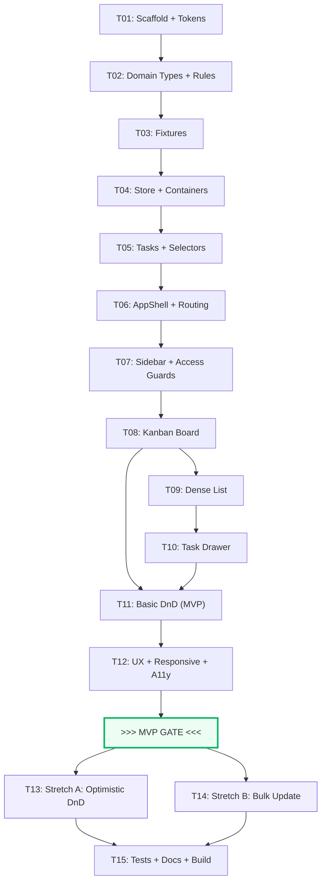

# Flowboard — Implementation Plan

> **Phases**: 5 | **Tasks**: 15 | **Batches**: 7
> **MVP Gate**: After Batch 5 (end of Phase 4)
> **Stretch Goals**: 2 (Phase 5, Batch 6)

---

## Future Incremental Build Workflow

Every requested Task or Batch follows this protocol:

```
IMPLEMENT → VERIFY → RUN CHECKS → REPORT → SUGGEST COMMIT → STOP
```

1. **IMPLEMENT**: Only the requested scope.
2. **VERIFY**: Against requirement IDs, architecture, testing strategy, acceptance criteria, static Figma materials.
3. **RUN CHECKS**: Tests / typecheck / build / manual checks appropriate to scope.
4. **REPORT**: Files created/changed, functionality completed, acceptance criteria status, tests/checks run, results, blockers, deviations, incomplete items.
5. **SUGGEST COMMIT**: One Conventional Commit message.
6. **STOP**: Wait for owner review. Never run `git add`, `git commit`, or `git push`.

If corrections are requested: correct → verify again → report again → suggest commit again → STOP.

---

## Phase Overview

| Phase | Name | Objective | Batches | Tasks |
|---|---|---|---|---|
| 1 | Foundation | Project scaffold, domain types, business rules, seed data | B1 | T01–T03 |
| 2 | State Layer | Zustand store, container/task operations, selectors | B2 | T04–T05 |
| 3 | Application Shell | App layout, routing, sidebar, navigation, user switching | B3 | T06–T07 |
| 4 | Core Product | Views, drawer, basic DnD, UX polish — completes all MVP requirements | B4, B5 | T08–T12 |
| 5 | Stretch & Finalization | Two stretch goals, automated tests, documentation, production build | B6, B7 | T13–T15 |

**MVP Gate** falls between Phase 4 and Phase 5.

---

## Batch Summary

| Batch | Tasks | Focus | Dependencies |
|---|---|---|---|
| B1 | T01, T02, T03 | Foundation: scaffold, domain, fixtures | None |
| B2 | T04, T05 | Store: container ops, task ops, selectors | B1 |
| B3 | T06, T07 | Shell: app layout, sidebar, routing, access guards | B2 |
| B4 | T08, T09, T10 | Views: kanban board, dense list, task drawer | B3 |
| B5 | T11, T12 | DnD + polish: basic kanban DnD, UX states, responsive, a11y | B4 |
| | **>>> MVP GATE <<<** | All mandatory Assignment requirements verified | |
| B6 | T13, T14 | Stretches: optimistic rollback, bulk update | B5 (MVP complete) |
| B7 | T15 | Finalization: automated tests, README, AI_USAGE, production build | B6 |

---

## Phase 1 — Foundation

**Objective**: Establish the project scaffold with verified design tokens, define all domain types and pure business rules, and create the seed dataset. After this phase, every type, pure function, and fixture is available for the store and UI layers.

**Why it exists**: All subsequent phases import from `domain/` and `store/fixtures.ts`. Building these first ensures type safety and testable business logic from the start.

**Dependencies**: None.

**Exit criteria**: `tsc --noEmit` passes; domain types compile; pure functions are importable; fixtures satisfy structural invariants (status coverage, valid parentage, grant consistency).

---

### T01 — Project Scaffold + Design Token Configuration

**Goal**: Initialize a Vite + React + TypeScript project with strict Tailwind CSS configuration using all verified Figma design tokens.

**Why This Task Comes Now**: Everything depends on the build toolchain and design system being in place first.

**Dependencies**: None.

**Requirement IDs Covered**: U-01, U-02, U-14

**Relevant References**: `docs/01-REQUIREMENTS.md` (U-01, U-02, U-14), `docs/02-ARCHITECTURE.md` §6 (Design System), Figma Verification Report §3 (Extracted Design Tokens)

**Static Figma References**: Design System screenshot (Screenshot 2) — color tokens, typography scale, spacing, radii, component specimens

**Scope**:
- Scaffold Vite + React 18 + TypeScript (strict mode) project
- Install and configure Tailwind CSS with custom theme extension:
  - `fb-*` color tokens (primary, primary-soft, canvas, sidebar, sidebar-active, text-primary, text-secondary, text-muted, text-subtle, border, border-soft, success, success-soft, success-banner, warning, warning-soft, danger, danger-soft, danger-border, danger-toast-title)
  - Additional danger tokens: urgent pill bg `#FEE4E2`, urgent pill text `#B42318`
  - Font family: `Inter, -apple-system, BlinkMacSystemFont, "Segoe UI", Roboto, sans-serif`
  - Border radii: `fb-sm` (8px), `fb-md` (10px), `fb-lg` (12px), `fb-xl` (14px), `fb-2xl` (16px)
  - Box shadows: `fb-button`, `fb-card`, `fb-drawer`, `fb-modal`, `fb-toast` (exact values from Figma report)
- Create `src/index.css` with Tailwind directives only
- Configure `tsconfig.json` with strict mode, path aliases
- Install Inter font (Google Fonts CDN link in `index.html`)
- Install Vitest + React Testing Library (test infrastructure — no tests yet)
- Install Zustand
- Install `lucide-react` for icons
- `.gitignore`, basic `package.json` scripts

**Likely Files/Modules**:
- `package.json`, `tsconfig.json`, `vite.config.ts`
- `tailwind.config.ts` (or `tailwind.config.js`)
- `postcss.config.js`
- `src/index.css`, `src/main.tsx`
- `index.html`
- `.gitignore`

**Production-Quality Considerations**:
- Strict TypeScript (`strict: true`, `noUncheckedIndexedAccess: true`)
- All Figma-verified token values must exactly match the extraction report
- No custom CSS beyond Tailwind directives in `index.css`

**Acceptance Criteria**:
1. `npm run dev` starts and renders a blank page with Inter font loaded
2. `tsc --noEmit` passes with zero errors
3. Tailwind config contains all `fb-*` tokens matching Figma report values
4. `src/index.css` contains only `@tailwind` directives (no custom CSS)

**Verification Plan**: Run `npm run dev`, verify dev server starts. Run `tsc --noEmit`. Inspect `tailwind.config` tokens against Figma report.

**Testing Required**: None (infrastructure only).

**Explicitly Out of Scope**: Application components, domain logic, store, routing.

---

### T02 — Domain Types + Pure Business Rules

**Goal**: Implement all domain entity types, the typed error/result contract, and all pure business-rule functions (permissions, ordering, task movement, constants).

**Why This Task Comes Now**: Types and pure functions are the foundation. The store (T04–T05) imports these. Tests (T15) test these. Every component references these types.

**Dependencies**: T01 (TypeScript compiles).

**Requirement IDs Covered**: H-01, H-02, H-03, H-04, H-12, T-01, T-02, T-03, T-12, S-01, S-02, S-03, S-05, S-06, P-06, P-07, P-08, P-09, D-01, D-04, D-08

**Relevant References**: `docs/01-REQUIREMENTS.md` (H-01..H-04, T-01..T-03, S-01..S-06, P-06..P-09, D-01..D-08), `docs/02-ARCHITECTURE.md` §3 (Domain Layer), §3.1..§3.3

**Scope**:
- `src/domain/types.ts`: All entity interfaces and type unions
  - `ContainerType`, `ContainerNode` (with `isPrivate`, `archived`)
  - `TaskPriority`, `Task` (all fields per Assignment §2)
  - `StatusCategory`, `StatusColor`, `TaskStatus`
  - `UserRole`, `User`
  - `GrantMode`, `Grant`
  - `Capability` union, `RoleDefinition` interface
  - `StaticActivityEntry` (with `userId`, `relativeTime` per Decision 1)
  - `AppErrorCode` union, `AppResult<T>` discriminated union
- `src/domain/permissions.ts`: Capability-based authorization policy engine
  - `can(userId, capability, resourceId, context)` pure policy engine with 5-step deterministic precedence (archive → effective capability → bypass → hierarchical grants → public/private visibility)
  - `getEffectiveCapabilities(roleId, roleDefinitions)` with role inheritance, cycle safety, and deduplication
  - Semantic wrappers: `canViewNode()`, `canCreateTask()`, `canEditTask()`, `canDeleteTask()`, `canMoveTask()`, `canCreateContainer()`, `canRenameContainer()`, `canArchiveContainer()`, `canReorderContainer()`
  - Symmetric cross-list move verification on source and destination lists
  - Hierarchical grant propagation (ALLOW propagates down, DENY blocks subtree, DENY strictly wins over ALLOW)
- `src/domain/ordering.ts`: Position and sorting helpers
  - `reindexPositions<T>(items: T[]): T[]`
  - Priority comparator, due-date comparator, stable tie-breaking
- `src/domain/task-movement.ts`: Cross-list movement logic
  - `resolveDestinationStatus()`
- `src/domain/constants.ts`: Static maps
  - `STATUS_COLOR_STYLES` (Tailwind class map)
  - `PRIORITY_ORDER`, `PRIORITY_LABELS`
  - `VALID_PARENT_TYPES`
- Injectable `now()` timestamp factory for deterministic testing

**Likely Files/Modules**:
- `src/domain/types.ts`
- `src/domain/permissions.ts`
- `src/domain/ordering.ts`
- `src/domain/task-movement.ts`
- `src/domain/constants.ts`
- `src/domain/index.ts` (barrel export)

**Production-Quality Considerations**:
- Zero React or Zustand imports in `domain/`
- All functions are pure (state passed as arguments)
- `canViewNode` ancestor traversal must not infinite-loop on malformed data
- `reindexPositions` must handle empty arrays
- All type unions must be exhaustive where used

**Acceptance Criteria**:
1. `tsc --noEmit` passes
2. All four permission functions are implemented with correct evaluation order
3. `reindexPositions([])` returns `[]`; `reindexPositions` of 3 items returns positions `[0, 1, 2]`
4. `resolveDestinationStatus` falls back to lowest-position status when no category match
5. `STATUS_COLOR_STYLES` covers all 5 `StatusColor` values
6. `VALID_PARENT_TYPES` enforces strict 4-tier hierarchy
7. No React or Zustand imports in any `domain/` file

**Verification Plan**: `tsc --noEmit`. Manual review of permission evaluation order against `docs/01-REQUIREMENTS.md` (P-06) and `docs/02-ARCHITECTURE.md` §3.2.

**Testing Required**: None yet (tested in T15). Functions are designed to be independently testable.

**Explicitly Out of Scope**: Store implementation, React components, fixtures.

---

### T03 — Seed Fixtures + Fixture Validation

**Goal**: Create the complete seed dataset that satisfies all Assignment fixture requirements and structural invariants.

**Why This Task Comes Now**: The store (T04) initializes from these fixtures. Fixtures must be valid before the store can use them.

**Dependencies**: T02 (domain types exist).

**Requirement IDs Covered**: D-02, S-07, P-01, P-03, P-04, P-05, D-07, DR-08

**Relevant References**: `docs/01-REQUIREMENTS.md` (D-02, S-07, P-01..P-05), `docs/02-ARCHITECTURE.md` §4 (Fixture Contract)

**Scope**:
- `src/store/fixtures.ts`: Complete seed dataset
  - 1 Workspace: "Flowboard Workspace"
  - 2 Spaces: "Engineering" (public), "Marketing" (private)
  - 2 Folders: "Q2 Launch" (public, under Engineering), "Campaigns" (public, under Marketing)
  - 3 Lists: "Backlog" (under Q2 Launch), "Sprint 18" (under Q2 Launch), "Growth Campaigns" (under Campaigns)
  - List-scoped statuses:
    - Backlog: To Do (gray), In Progress (blue), Done (green)
    - Sprint 18: To Do (gray), In Progress (blue), In Review (purple), Done (green) — custom status
    - Growth Campaigns: To Do (gray), In Progress (blue), Done (green)
  - 15+ tasks distributed across lists with diverse priorities, assignees, due dates
  - 3 Users: Alice (admin), Bob (member), Carol (member)
  - Grants:
    - Bob: explicit `DENY` on Sprint 18
    - Carol: explicit `ALLOW` on Marketing
    - (Engineering, Q2 Launch, Backlog are public — visible to all members by default)
  - `activityByTaskId` map: 2–3 static entries per task with `userId`, `text`, `relativeTime`
  - `nextTaskNumber`: set to next available number after seeded tasks
- Validate fixture invariants at development time:
  - Every list has ≥1 todo, ≥1 in_progress, ≥1 done status
  - Every task's `statusId` belongs to its `primaryListId`'s status set
  - Every task's `assigneeIds` reference valid users
  - Container parentage follows strict 4-tier rules
  - Positions are contiguous within sibling groups

**Likely Files/Modules**:
- `src/store/fixtures.ts`

**Production-Quality Considerations**:
- Fixtures must produce a compelling demo: realistic task titles, varied priorities, varied due dates (some overdue, some today, some future, some null)
- Task IDs follow the `FE-###` pattern
- Timestamps use realistic ISO datetime strings
- Activity entries are consistent with task status/assignees

**Acceptance Criteria**:
1. `tsc --noEmit` passes
2. Fixture dataset contains: 1 workspace, 2 spaces, 2 folders, 3 lists, 15+ tasks, 3 users
3. Sprint 18 has 4 statuses (including custom "In Review")
4. Bob's expected visibility: Engineering, Q2 Launch, Backlog (NOT Sprint 18, NOT Marketing subtree)
5. Carol's expected visibility: Engineering, Q2 Launch, Backlog, Sprint 18, Marketing, Campaigns, Growth Campaigns
6. Alice sees everything non-archived
7. All fixture invariants hold (status coverage, parentage, position contiguity)

**Verification Plan**: `tsc --noEmit`. Manual review of grant/visibility expectations against `docs/01-REQUIREMENTS.md` (P-01..P-05) and `docs/02-ARCHITECTURE.md` §4.

**Testing Required**: Fixture invariants will be exercised by permission tests in T15.

**Explicitly Out of Scope**: Store implementation, UI components.

---

## Phase 2 — State Layer

**Objective**: Build the Zustand canonical store with all container and task operations, guarded by domain permission functions, with derived-state selectors.

**Why it exists**: The UI (Phases 3–4) needs a fully functional data layer. Building the store before UI ensures mutations are correct and testable independently.

**Dependencies**: Phase 1 (types, domain rules, fixtures).

**Exit criteria**: All CRUD operations work correctly. Permission guards return `FORBIDDEN` for unauthorized access. Selectors produce filtered trees and kanban columns. `tsc --noEmit` passes.

---

### T04 — Canonical Store Foundation + Container Operations

**Goal**: Create the Zustand store with normalized canonical state, session state, and all container CRUD operations with admin-only guards.

**Why This Task Comes Now**: Tasks, views, and all UI depend on the store. Container operations must be in place before the sidebar (T07) can use them.

**Dependencies**: T02 (domain types + permission functions), T03 (fixtures).

**Requirement IDs Covered**: H-05, H-06, H-07, H-08, H-09, H-10, H-11, H-12, D-03, D-05, D-06, P-10

**Relevant References**: `docs/01-REQUIREMENTS.md` (H-05..H-12, D-03, D-06, P-10), `docs/02-ARCHITECTURE.md` §2.1 (State Ownership), §5.1 (Container Mutations)

**Scope**:
- `src/store/store.ts`: Zustand store definition
  - **Canonical state**: `containersById`, `statusesById`, `usersById`, `grants`, `nextTaskNumber`, `activityByTaskId` — initialized from fixtures
  - **Session state**: `activeUserId` (default: Alice), `viewMode` ('board'), `simulateFailureNext` (false), `taskMutationInFlight` (false)
  - **Container mutations** (all return `AppResult`):
    - `createContainer(parentId, name, type)` — validates parentage via `VALID_PARENT_TYPES`, admin-only via `canManageContainers`
    - `createList(parentId, name)` — atomic: creates container + 3 default statuses in one operation
    - `renameContainer(id, name)` — admin-only
    - `archiveContainer(id)` — admin-only, sets `archived: true`
    - `moveContainerUp(id)` / `moveContainerDown(id)` — admin-only, swaps positions + `reindexPositions`
  - **Session mutations**:
    - `setActiveUser(userId)` — returns `INVARIANT_VIOLATION` if `taskMutationInFlight` is true
    - `setViewMode(mode)`
    - `toggleSimulateFailure()`
    - `resetData()` — reinitializes from fixtures
  - **`tasksById`**: initialized from fixtures (mutations added in T05)

**Likely Files/Modules**:
- `src/store/store.ts`

**Production-Quality Considerations**:
- Every fallible mutation returns `AppResult<T>`
- Container mutations must not partially mutate on validation failure
- `createList` atomicity: if status creation somehow fails after container creation, both must be rolled back (in practice, synchronous in-memory operations don't fail, but the code structure should be atomic)
- `setActiveUser` must check `taskMutationInFlight` before changing `activeUserId`

**Acceptance Criteria**:
1. Store initializes from fixtures with correct entity counts
2. `createContainer` with invalid parent type returns `INVALID_PARENTAGE`
3. `createContainer` by member (Bob/Carol) returns `FORBIDDEN`
4. `createList` creates container + 3 default statuses atomically
5. `archiveContainer` sets `archived: true`
6. `setActiveUser` during `taskMutationInFlight` returns `INVARIANT_VIOLATION`
7. `tsc --noEmit` passes

**Verification Plan**: `tsc --noEmit`. Manually invoke mutations in dev console or temporary test.

**Testing Required**: Store-level tests in T15.

**Explicitly Out of Scope**: Task mutations (T05), selectors (T05), UI components.

---

### T05 — Task Operations + Mutation Infrastructure + Selectors

**Goal**: Implement all task CRUD operations with the `taskMutationInFlight` lock, cross-list movement, and all derived-state selectors.

**Why This Task Comes Now**: Views (Phase 4) need task mutations and selectors. The kanban board needs `getKanbanColumns`, the list view needs `getSortedTasks`, the sidebar needs `getFilteredTree`.

**Dependencies**: T04 (store foundation exists).

**Requirement IDs Covered**: T-04, T-05, T-06, T-07, T-08, T-09, T-10, T-11, T-12, T-13, D-06, D-07, P-06, P-07, P-08, P-09, P-12, P-13, P-16, TE-01, TE-03, TE-04, TE-05, TE-06

**Relevant References**: `docs/01-REQUIREMENTS.md` (T-04..T-13, D-06, D-07, P-06..P-09, P-12, P-13, P-16, TE-01..TE-06), `docs/02-ARCHITECTURE.md` §2.1 (Derived State), §3.2 (Permissions), §5.2 (Task Mutations), `docs/03-TESTING-STRATEGY.md` §1

**Scope**:
- **Task mutations** (added to store, all return `AppResult`, all use `taskMutationInFlight` lock with `try...finally`):
  - `createTask(listId, data)` — validates title, assigns default todo status, generates `FE-###` ID, appends to end of column, assigns contiguous integer position `0..n-1` via `reindexPositions`
  - `updateTask(taskId, patch)` — validates title length, validates statusId belongs to list, capability check via `canEditTask` (`task.update`)
  - `deleteTask(taskId)` — capability check (`task.delete`), removes task, reindexes affected column (`0..n-1`)
  - `moveTaskStatus(taskId, newStatusId, newPosition)` — same-list status/position change (kanban drop), deterministic integer positions `0..n-1` via `reindexPositions` on source and destination columns
  - `moveTaskToList(taskId, destListId)` — cross-list movement with `resolveDestinationStatus`, symmetric capability checks (`task.move`) on both lists, `reindexPositions` on all affected columns
  - `reorderTask(taskId, newPosition)` — within same status column reorder, delegates to `moveTaskStatus`
- **Selectors** (`src/store/selectors.ts`):
  - `getFilteredTree(userId)` — permission-filtered container hierarchy tree using `canViewNode`, excludes archived
  - `getKanbanColumns(listId)` — groups tasks by status, sorted by position within each column
  - `getSortedTasks(listId, sortKey, sortDir)` — sorted task array for dense list view
  - `getListStatuses(listId)` — statuses for a list, sorted by position
  - `getBreadcrumbs(listId)` — ancestor chain for breadcrumb navigation
  - `getTaskCount(listId)` — task count for sidebar badge
  - `getVisibleLists(userId)` — all visible lists for route fallback/redirect
- **Mandatory Domain & Store Tests** (`src/__tests__/permissions.test.ts`):
  - Role capabilities & inheritance (`getEffectiveCapabilities`, Admin inherits Member, deduplication, cycle protection)
  - Alice admin bypass (`permission.bypass` on non-archived containers)
  - Bob visibility: public Engineering subtree except denied Sprint 18; no Marketing subtree
  - Carol visibility: Engineering and Marketing subtrees (inherited ALLOW grant)
  - Deny-wins precedence: ancestor DENY blocks descendant even if descendant has ALLOW
  - Archive precedence: archived containers and ancestors hidden from all users, even Alice with bypass
  - Member task mutation in accessible list vs. denied list returns `FORBIDDEN` with zero state change
  - Cross-list move requires `task.move` on both source and destination lists symmetrically
  - Future role safety: test-only Viewer role can read but cannot update (view != edit)
  - Container management by member returns `FORBIDDEN` (missing `container.*` capabilities)
  - Invalid container parentage returns `INVALID_PARENTAGE`
  - Atomic list creation creates container + 3 default statuses
  - Mutation lock protects user switch during in-flight mutations

**Likely Files/Modules**:
- `src/store/store.ts` (task mutations added)
- `src/store/selectors.ts`
- `src/__tests__/permissions.test.ts`

**Production-Quality Considerations**:
- Every task mutation acquires `taskMutationInFlight`, executes in `try`, releases in `finally`
- Cross-list movement is a single atomic operation (not two separate mutations)
- Selectors should use Zustand's selector pattern for efficient re-rendering
- `getFilteredTree` must use `canViewNode` for every container
- `getKanbanColumns` must not include tasks from archived lists
- Tests must execute against a cleanly reset fixture state per test

**Acceptance Criteria**:
1. `createTask` generates correct `FE-###` ID and defaults to lowest-position todo status
2. `moveTaskToList` remaps status via `resolveDestinationStatus` and checks both list permissions
3. `moveTaskStatus` updates status and reindexes both source and destination columns
4. `deleteTask` removes task and reindexes remaining tasks in column
5. All task mutations respect `taskMutationInFlight` lock
6. `getFilteredTree` returns correct visible containers for Alice, Bob, Carol
7. `getKanbanColumns` groups and sorts tasks correctly
8. All mandatory permission and store guard tests in `src/__tests__/permissions.test.ts` pass
9. `tsc --noEmit` passes

**Verification Plan**: `tsc --noEmit && npm test`.

**Testing Required**: `src/__tests__/permissions.test.ts` covering all domain permissions and store mutation invariants.

**Explicitly Out of Scope**: UI components, DnD, optimistic rollback, bulk update full implementation.

---

## Phase 3 — Application Shell

**Objective**: Build the responsive app shell (topbar, sidebar, main content area), hash routing, user switching, and container management UI. After this phase, users can navigate the hierarchy, switch users, and see permission-filtered content areas.

**Why it exists**: The core views (Phase 4) need to render inside the app shell. The sidebar tree determines which list is active.

**Dependencies**: Phase 2 (store with selectors).

**Exit criteria**: App renders with sidebar tree, topbar, user switcher. Switching users immediately updates the visible tree. Navigating to a list updates the hash route. 403 card shows for forbidden lists. Responsive sidebar works at all breakpoints.

---

### T06 — AppShell Layout + Topbar + Hash Routing + User Switching

**Goal**: Implement the responsive application shell with topbar, hash-based routing, view toggle, and user switching.

**Why This Task Comes Now**: The sidebar (T07) and all views (Phase 4) render inside this shell. Routing determines which list is active.

**Dependencies**: T04, T05 (store with session state + selectors).

**Requirement IDs Covered**: V-10, V-11, P-02, P-11, P-15, U-03, U-10, U-12, D-05

**Relevant References**: `docs/01-REQUIREMENTS.md` (V-10, V-11, P-02, P-11, P-15, U-03, U-10, U-12, D-05), `docs/02-ARCHITECTURE.md` §5.3 (Routing & Access Guards), §6 (Responsive Strategy)

**Static Figma References**: Screenshots 1, 3, 4 (topbar, user switcher, breadcrumbs, simulation toggle)

**Scope**:
- `src/components/app/App.tsx`: Root component
  - Hash route parsing (`#/list/:listId`)
  - `key={activeUserId}` on content container for clean reset on user switch
  - Route reconciliation on user switch (redirect if current list becomes inaccessible)
- `src/components/app/AppShell.tsx`: Layout container
  - Desktop: fixed 248px sidebar + main content
  - Tablet/mobile: off-canvas sidebar trigger
  - 58px topbar
- `src/components/app/Topbar.tsx`:
  - Flowboard branding/logo
  - Search input (visual only, non-functional)
  - "Simulation: Normal" / "Simulation: Armed" toggle pill
  - User switcher dropdown (Alice/Bob/Carol with role labels)
  - "Viewing as \<User\> · \<Role\>" indicator
  - Disabled state when `taskMutationInFlight` is true (user switcher only)
  - Responsive: compact on tablet/mobile
- `src/components/app/WorkspaceHeader.tsx`:
  - Breadcrumbs from `getBreadcrumbs(listId)`
  - Page title (list name)
  - Task count badge
  - Board / List view toggle
  - "+ New task" button (opens drawer in create mode — wired in T10)
  - Filter / Sort buttons (visual only)
- `src/hooks/useActiveList.ts`: Reads `listId` from hash, provides `activeListId`
- `src/hooks/useRouteGuard.ts`: Validates access on user switch, redirects if needed
- Basic `hashchange` event listener for route updates

**Likely Files/Modules**:
- `src/components/app/App.tsx`
- `src/components/app/AppShell.tsx`
- `src/components/app/Topbar.tsx`
- `src/components/app/WorkspaceHeader.tsx`
- `src/hooks/useActiveList.ts`
- `src/hooks/useRouteGuard.ts`
- `src/components/shared/Avatar.tsx`

**Production-Quality Considerations**:
- User switcher must be disabled (not hidden) when `taskMutationInFlight` is true, with `cursor-not-allowed`
- Hash route parsing must handle edge cases: no hash, invalid list ID, empty hash
- Breadcrumbs must use `getBreadcrumbs` selector, not manual traversal
- Responsive layout must use Tailwind utilities, not JS resize listeners

**Acceptance Criteria**:
1. App renders with sidebar area + topbar + main content area
2. Hash route `#/list/:listId` selects the correct list
3. Default route redirects to first visible list
4. User switcher changes `activeUserId` and immediately updates displayed user
5. Route reconciliation redirects to first visible list when current list becomes inaccessible after user switch
6. "Viewing as \<User\> · \<Role\>" banner visible
7. Simulation toggle toggles `simulateFailureNext`
8. Responsive: sidebar area collapses below 1024px
9. `tsc --noEmit` passes

**Verification Plan**: `npm run dev`. Switch users and verify route/tree updates. Resize browser to verify responsive behavior.

**Testing Required**: None (route guard behavior tested via permission tests in T15).

**Explicitly Out of Scope**: Sidebar tree content (T07), kanban/list views (T08–T09), drawer (T10), DnD.

---

### T07 — Sidebar Tree + Container Management + Access Guards

**Goal**: Implement the permission-filtered collapsible sidebar tree with admin container management and the 403 Restricted Card for forbidden list access.

**Why This Task Comes Now**: The sidebar drives list selection for all views. Route guards need the 403 card. Container management is admin CRUD tied to the tree.

**Dependencies**: T06 (app shell + routing exists).

**Requirement IDs Covered**: V-08, V-09, H-05, H-06, H-07, H-08, P-13, P-14, U-04, U-05, U-12, A-02

**Relevant References**: `docs/01-REQUIREMENTS.md` (V-08, V-09, H-05..H-08, P-13, P-14, U-04, U-05, U-12, A-02), `docs/02-ARCHITECTURE.md` §5.1 (Container Hierarchy), §5.3 (403 Restricted Card)

**Static Figma References**: Screenshots 1, 3 (sidebar tree), Screenshot 4 (Bob's pruned sidebar + 403 card), Figma nodes `1:572`, `1:779`, `1:882`

**Scope**:
- `src/components/sidebar/Sidebar.tsx`:
  - Desktop: fixed dark sidebar (`bg-fb-sidebar`, 248px)
  - Mobile/tablet: off-canvas drawer with backdrop, Escape close, focus trap, auto-close on list select
  - Hamburger menu button in topbar for mobile
  - "WORKSPACE" label + workspace name
- `src/components/sidebar/TreeNode.tsx`:
  - Recursive rendering: Space → Folder → List
  - Collapsible expand/collapse for Space and Folder nodes (local state)
  - Active list highlight (`bg-fb-sidebar-active`, `rounded-fb-sm`)
  - Task count badge on List nodes
  - Click on List → update hash route → load list
  - Hover/focus states for tree items
- `src/components/sidebar/ContainerMenu.tsx`:
  - Context menu (three-dot icon on hover, admin only)
  - Actions: Create child, Rename, Archive, Move Up, Move Down
  - Create: modal/inline input for new container name
  - Rename: modal/inline input
  - Archive: immediate with toast confirmation
  - Move Up/Down: immediate with `reindexPositions`
  - Hidden for members (Bob, Carol)
- `src/components/shared/RestrictedCard.tsx`:
  - 403 Forbidden card (Figma `Node 1:882`)
  - Lock illustration, "Access is intentionally restricted" heading
  - Explanation text, "403 · FORBIDDEN" sub-banner
  - "Go to \<first visible list\>" button
  - Centered in main content area (680 × 430px, radius 16px, `fb-modal` shadow)
- `src/components/shared/EmptyState.tsx`:
  - "No tasks here yet" illustration for empty lists (Figma `Node 1:963`)
  - "Add task" button
- Route guard integration:
  - If active list is denied → show RestrictedCard
  - If no visible list at all → show EmptyState
  - Archive reconciliation: if active list archived → redirect + toast

**Likely Files/Modules**:
- `src/components/sidebar/Sidebar.tsx`
- `src/components/sidebar/TreeNode.tsx`
- `src/components/sidebar/ContainerMenu.tsx`
- `src/components/shared/RestrictedCard.tsx`
- `src/components/shared/EmptyState.tsx`

**Production-Quality Considerations**:
- Tree must use `getFilteredTree(activeUserId)` — never manually filter in component
- Container menu actions must call store mutations and handle `AppResult` errors
- Off-canvas sidebar needs proper focus trap and `aria-expanded`
- Tree node expand/collapse is local transient state — not persisted in store
- Archive: if the archived container is the active list, redirect to first visible list

**Acceptance Criteria**:
1. Sidebar shows permission-filtered tree for each user (Alice sees all, Bob sees Engineering/Q2 Launch/Backlog only, Carol sees all including Marketing)
2. Clicking a list navigates to `#/list/:listId`
3. Active list is highlighted in sidebar
4. Space/Folder nodes collapse/expand on click
5. Admin (Alice) sees context menus; members (Bob/Carol) do not
6. Container create/rename/archive/move works for admin
7. Navigating to a forbidden list shows 403 Restricted Card
8. Mobile: sidebar opens as off-canvas drawer, closes on list select
9. `tsc --noEmit` passes

**Verification Plan**: `npm run dev`. Test tree filtering by switching users. Test 403 card by navigating to forbidden list as Bob. Test responsive sidebar at mobile width.

**Testing Required**: Permission filtering tested in T15.

**Explicitly Out of Scope**: Kanban/list views, task drawer, DnD.

---

## Phase 4 — Core Product

**Objective**: Implement the kanban board view, dense list view, task detail drawer, basic kanban DnD, and all required UX states. After this phase, every mandatory MVP requirement from the Assignment is complete.

**Why it exists**: This is the product core. Views, task CRUD UI, drag-and-drop, and polish deliver the full user-facing experience.

**Dependencies**: Phase 3 (app shell, routing, sidebar).

**Exit criteria**: All Assignment mandatory requirements are verifiable. Basic kanban DnD works. UX states (loading, empty, error, interaction feedback) are polished. Responsive layout verified at all target widths. User switching demonstrates permission differences within 30 seconds.

---

### T08 — Kanban Board View + TaskCard Component

**Goal**: Implement the kanban board with status columns and task cards.

**Why This Task Comes Now**: The board is the primary view. It depends on the app shell (T06–T07) and store selectors (T05).

**Dependencies**: T05 (selectors: `getKanbanColumns`, `getListStatuses`), T06–T07 (app shell renders main content).

**Requirement IDs Covered**: V-01, V-02, U-11, S-06

**Relevant References**: `docs/01-REQUIREMENTS.md` (V-01, V-02, U-11, S-06), `docs/02-ARCHITECTURE.md` §5.3 (View Projections), §3.3 (Status Color Styles)

**Static Figma References**: Screenshot 1 (kanban board — Dense List view), Screenshot 4 (kanban board — Board view), Figma node `1:89` (board canvas), `1:946` (task card specimen)

**Scope**:
- `src/components/board/KanbanBoard.tsx`:
  - Maps `getKanbanColumns(listId)` → `KanbanColumn` components
  - Horizontal scroll container (`overflow-x-auto`) with smooth scrolling
  - Column minimum width ~320px
  - Zero page-level horizontal overflow
- `src/components/board/KanbanColumn.tsx`:
  - Status dot + status name (from `STATUS_COLOR_STYLES`) + task count + "+" button
  - Vertical card list
  - Empty column placeholder (dotted border drop zone)
- `src/components/board/TaskCard.tsx`:
  - Task ID label (e.g., "FE-136")
  - Title
  - Priority badge (color from `PRIORITY_ORDER` + design tokens)
  - Assignee avatars (initials-based)
  - Due date with calendar icon
  - Overdue indicator (red text for past due dates)
  - Priority dot (top-right corner, colored)
  - Click → opens Task Drawer in Edit mode (wired in T10)
  - Hover: subtle elevation / border change
  - Card styling: white background, `fb-card` shadow, `rounded-fb-lg`, `fb-border` border
- `src/components/shared/PriorityBadge.tsx`: Priority pill with icon + label + color
- `src/components/shared/StatusPill.tsx`: Status badge with `STATUS_COLOR_STYLES`

**Likely Files/Modules**:
- `src/components/board/KanbanBoard.tsx`
- `src/components/board/KanbanColumn.tsx`
- `src/components/board/TaskCard.tsx`
- `src/components/shared/PriorityBadge.tsx`
- `src/components/shared/StatusPill.tsx`

**Production-Quality Considerations**:
- Cards must be scannable: title + priority + assignees + due date visible at a glance
- Status colors must be consistent between board columns and list rows (use same `STATUS_COLOR_STYLES`)
- Priority colors must be consistent between board cards and list rows
- Kanban columns must scroll vertically independently

**Acceptance Criteria**:
1. Board renders columns for each status in the active list, ordered by `status.position`
2. Cards display title, priority badge, assignee avatars, and due date
3. Empty columns show placeholder
4. Status dot colors match `STATUS_COLOR_STYLES`
5. Board scrolls horizontally without page-level horizontal overflow
6. Switching lists updates the board
7. `tsc --noEmit` passes

**Verification Plan**: `npm run dev`. Verify board renders with seed data. Check status colors. Verify horizontal scroll.

**Testing Required**: None (visual verification).

**Explicitly Out of Scope**: DnD (T11), drawer (T10), list view (T09).

---

### T09 — Dense List View + Table Sorting

**Goal**: Implement the dense list table view with sortable priority and due-date columns.

**Why This Task Comes Now**: The list view is the second required view. It shares components (StatusPill, PriorityBadge, Avatar) with the board.

**Dependencies**: T08 (shared components: PriorityBadge, StatusPill, Avatar exist).

**Requirement IDs Covered**: V-05, V-06, V-07, U-11

**Relevant References**: `docs/01-REQUIREMENTS.md` (V-05..V-07, U-11), `docs/02-ARCHITECTURE.md` §5.3 (Dense List View), Figma node `1:571`

**Static Figma References**: Screenshot 3 (Dense List view with table rows)

**Scope**:
- `src/components/list/ListView.tsx`:
  - Table container with column headers: Task, Status, Priority, Assignees, Due
  - Uses `getSortedTasks(listId, sortKey, sortDir)` selector
  - Sort state: `sortKey` ('priority' | 'dueDate' | null), `sortDir` ('asc' | 'desc') — local state
  - Clickable sort headers for Priority and Due Date columns
  - Sort indicators (arrow icons) on active sort column
  - Responsive: internal horizontal scroll below 768px
- `src/components/list/ListRow.tsx`:
  - Task ID + Title
  - Status pill
  - Assignee avatars
  - Priority badge
  - Due date with overdue styling
  - Click → opens Task Drawer in Edit mode (wired in T10)
  - Hover: subtle background highlight
  - Chevron ">" on right side indicating clickable
- Informational footer banner (Figma `Node 1:772`): "Dense by design" tip (visual nicety)

**Likely Files/Modules**:
- `src/components/list/ListView.tsx`
- `src/components/list/ListRow.tsx`

**Production-Quality Considerations**:
- Sorting must use deterministic comparators from `domain/ordering.ts`
- Default sort: position-based (no sort active)
- Table must remain scannable: consistent column widths, readable at dense desktop sizes
- Row hover state must be clear but not distracting

**Acceptance Criteria**:
1. Table renders all tasks in the active list
2. Clicking Priority header sorts by priority (urgent → none for desc, reverse for asc)
3. Clicking Due Date header sorts by due date (earliest first for asc, null last)
4. Sort is stable (ties broken by position then id)
5. Clicking a row will open the drawer (wired in T10, but row click handler is ready)
6. Table scrolls horizontally on narrow screens without page-level overflow
7. `tsc --noEmit` passes

**Verification Plan**: `npm run dev`. Click sort headers, verify ordering. Resize to verify responsive table scroll.

**Testing Required**: None (visual + sorting logic is tested indirectly via domain functions).

**Explicitly Out of Scope**: Bulk selection (T14), drawer (T10), DnD.

---

### T10 — Task Detail Drawer + Task CRUD UI

**Goal**: Implement the accessible task detail drawer with Create and Edit modes, controlled draft behavior, and all task CRUD UI operations.

**Why This Task Comes Now**: The drawer is the primary task interaction surface. Board cards (T08) and list rows (T09) need it as their click target. The "+ New task" button (T06) opens it.

**Dependencies**: T08, T09 (card/row click targets exist), T05 (task store mutations exist).

**Requirement IDs Covered**: DR-01 through DR-09, T-05, T-06, T-07, T-08, T-09, U-06, U-09, A-01, A-04, TE-02, TE-07

**Relevant References**: `docs/01-REQUIREMENTS.md` (DR-01..DR-09, T-05..T-09, U-06, U-09, A-01, A-04, TE-02, TE-07), `docs/02-ARCHITECTURE.md` §5.4 (Task Detail Drawer), §8 (Accessibility), `docs/03-TESTING-STRATEGY.md` §2

**Static Figma References**: Screenshot 5 (Task Drawer with properties, description, activity), Figma node `1:501` (drawer panel), `1:551` (activity area)

**Scope**:
- `src/hooks/useDrawer.ts`:
  - State: `isOpen`, `mode` ('create' | 'edit'), `taskId`, `draft`, `isDirty`
  - Actions: `openCreate(listId)`, `openEdit(taskId)`, `updateDraft(field, value)`, `save()`, `requestClose()`, `confirmDiscard()`, `deleteTask()`
  - `save()`: validates title (required, ≤500 chars), calls `createTask` or `updateTask`, handles `AppResult`
  - `requestClose()`: if dirty → trigger discard confirmation; if clean → close
  - Cross-list: updating draft's list ID remaps status via `resolveDestinationStatus`
- `src/components/drawer/TaskDrawer.tsx`:
  - Accessible dialog: `role="dialog"`, `aria-modal="true"`, focus trap, Escape, overlay click → `requestClose()`
  - Focus restoration to triggering card/row on close
  - **Header**: Task ID + Status pill + "..." menu + Close button
  - **Title field**: Large text input, auto-focused in Create mode
  - **Description field**: Textarea (plain text)
  - **Properties grid**: Status (dropdown), Priority (dropdown), Assignees (multi-select), Due Date (date picker), List (dropdown for cross-list move)
  - **"Saved" / "Unsaved changes" indicator** (green badge when clean, amber when dirty)
  - **Activity area**: Static read-only entries from `activityByTaskId` — user avatar, text, relativeTime
  - **Footer**: Primary CTA ("Create task" / "Save changes"), Delete button (Edit mode only, opens confirmation)
  - Create/Save/Delete buttons disabled when `taskMutationInFlight` is true
  - Responsive: 488px right panel on desktop, full-width on mobile
  - `fb-drawer` shadow
- `src/components/drawer/ConfirmDialog.tsx`:
  - Reusable confirmation modal for discard and delete actions
  - Accessible: focus trap, Escape, overlay click
  - `fb-modal` shadow, `16px` radius
  - Danger button styling for destructive actions
- `src/hooks/useToast.ts`:
  - Toast message queue with auto-dismiss timer
  - Used by drawer (and later by DnD, bulk update) for success/error feedback
- `src/components/shared/Toast.tsx`:
  - Error toast (Figma `Node 1:973`): red circle icon + title + subtext
  - Success toast: green styling
  - `aria-live="polite"`
  - Position: bottom-right desktop, bottom-center mobile
  - `fb-toast` shadow, `rounded-fb-lg`
  - Auto-dismiss after ~4 seconds
- **Mandatory RTL Component Test** (`src/__tests__/TaskDrawer.test.tsx`):
  - Renders Create mode with empty fields and "Create task" CTA
  - Renders Edit mode with populated fields and "Save changes" CTA
  - Editing a field marks drawer as dirty ("Unsaved changes")
  - `requestClose()` on dirty drawer shows discard confirmation
  - Clean drawer closes immediately on `requestClose()`

**Likely Files/Modules**:
- `src/hooks/useDrawer.ts`
- `src/hooks/useToast.ts`
- `src/components/drawer/TaskDrawer.tsx`
- `src/components/drawer/ConfirmDialog.tsx`
- `src/components/shared/Toast.tsx`
- `src/__tests__/TaskDrawer.test.tsx`

**Production-Quality Considerations**:
- Draft mutations are local only — never trigger store re-renders
- Focus trap must work with all interactive elements inside the drawer
- Focus must return to the triggering element (card or row) on close
- Date picker should use native `<input type="date">` for simplicity (no heavy date library)
- Dropdown selects should use native `<select>` or lightweight custom dropdowns
- `requestClose()` is the ONLY close path — never bypass it

**Acceptance Criteria**:
1. "+ New task" opens drawer in Create mode with empty fields and active list pre-selected
2. Clicking a board card or list row opens drawer in Edit mode with task data populated
3. Editing a field marks drawer as "Unsaved changes"
4. "Save changes" validates title, commits to store, returns to "Saved"
5. Closing dirty drawer triggers discard confirmation
6. Escape and overlay click go through `requestClose()`
7. Delete button shows confirmation prompt; confirming deletes task
8. Cross-list dropdown remaps status via `resolveDestinationStatus`
9. Activity area shows static seeded entries with avatar, text, relativeTime
10. Toast appears for errors (permission denied, validation failure) and success
11. Responsive: full-width drawer on mobile
12. All RTL tests in `src/__tests__/TaskDrawer.test.tsx` pass
13. `tsc --noEmit` passes

**Verification Plan**: `npm run dev` for manual interaction check. `tsc --noEmit && npm test` to verify component test suite.

**Testing Required**: RTL component test `src/__tests__/TaskDrawer.test.tsx`.

**Explicitly Out of Scope**: DnD (T11), bulk update (T14).

---

### T11 — Basic Kanban DnD (MVP Mandatory)

**Goal**: Implement drag-and-drop on the kanban board for within-column reorder and cross-column status moves. This is mandatory MVP functionality, NOT a stretch goal.

**Why This Task Comes Now**: DnD depends on the kanban board (T08) being fully rendered with cards. It's the last major interactive feature before UX polish.

**Dependencies**: T08 (kanban board rendered), T05 (store: `moveTaskStatus`, `reorderTask`).

**Requirement IDs Covered**: V-03, V-04, U-08

**Relevant References**: `docs/01-REQUIREMENTS.md` (V-03, V-04, U-08), `docs/02-ARCHITECTURE.md` §5.5 (Basic Kanban DnD), §5.2 (Mutation Lock)

**Static Figma References**: Screenshot 4 (kanban board), Screenshot 2 (design system — card specimen), Figma node `1:946`

**Scope**:
- Install `@dnd-kit/core` and `@dnd-kit/sortable`
- **DnD Provider** in `KanbanBoard.tsx`:
  - `DndContext` with sensors: `PointerSensor` (distance: 4px), `TouchSensor` (delay: 250ms, tolerance: 5px), `KeyboardSensor` where practical
  - `onDragStart`: set active drag item (local state)
  - `onDragOver`: update drag-over target (local state only — zero store writes)
  - `onDragEnd`: compute destination status + position, call `moveTaskStatus` or `reorderTask`
- **Sortable cards** in `KanbanColumn.tsx`:
  - `useSortable` on each `TaskCard`
  - CSS transform/transition via `@dnd-kit` (inline `style=` for transform — `// DND-EXCEPTION`)
- **DragOverlay** in `KanbanBoard.tsx`:
  - Elevated card preview matching card specimen styling
  - Subtle visual differentiation (shadow, slight opacity)
  - `// DND-EXCEPTION` comment on required inline styles
- **Drop target highlight**:
  - Active column gets `border-fb-primary` + subtle `bg-fb-primary-soft/30` when card hovers over it
- **Single store mutation on drop**:
  - `onDragEnd` computes target statusId + target position index
  - Calls store `moveTaskStatus(taskId, newStatusId, newPosition)` — which does `reindexPositions` on both columns
  - Or `reorderTask(taskId, newPosition)` for same-column reorder
- Basic DnD works reliably WITHOUT optimistic rollback (stretch)

**Likely Files/Modules**:
- `src/components/board/KanbanBoard.tsx` (DndContext, DragOverlay, onDragEnd)
- `src/components/board/KanbanColumn.tsx` (SortableContext, droppable)
- `src/components/board/TaskCard.tsx` (useSortable)
- `package.json` (add `@dnd-kit/core`, `@dnd-kit/sortable`, `@dnd-kit/utilities`)

**Production-Quality Considerations**:
- All `@dnd-kit` required inline `style=` attributes must have `// DND-EXCEPTION` comment
- Zero store mutations during drag-over — only CSS transforms
- Single canonical store mutation on final drop
- Drag should be disabled when `taskMutationInFlight` is true (cursor: not-allowed)
- Keyboard DnD: document what works with KeyboardSensor in README

**Acceptance Criteria**:
1. Dragging a card within a column reorders it; position persists after drop
2. Dragging a card to another column changes its status; position persists after drop
3. DragOverlay shows elevated card preview during drag
4. Drop target column shows visual highlight when card hovers over it
5. Exactly one store mutation occurs on drop (no intermediate writes)
6. Drag is disabled when `taskMutationInFlight` is true
7. Touch drag works with 250ms delay
8. `// DND-EXCEPTION` comments present on all inline style attributes
9. `tsc --noEmit` passes

**Verification Plan**: `npm run dev`. Drag cards within and between columns. Verify positions persist on page reload (re-seed). Test touch drag on mobile. Inspect console for store mutation count.

**Testing Required**: Manual DnD testing. Automated DnD testing deferred (complex to automate reliably).

**Explicitly Out of Scope**: Optimistic rollback (T13), bulk update (T14).

---

### T12 — UX States + Responsive Polish + Accessibility

**Goal**: Implement all required UX states (loading skeletons, empty states, error feedback, interaction polish), verify responsive layout at all target widths, and ensure accessibility compliance.

**Why This Task Comes Now**: This is the final MVP polish task. All features must be working before this task adds the required interaction quality layer.

**Dependencies**: T06–T11 (all features rendered and functional).

**Requirement IDs Covered**: U-04, U-05, U-06, U-07, U-12, U-13, U-14, A-01, A-02, A-03, A-04, A-05, A-06

**Relevant References**: `docs/01-REQUIREMENTS.md` (U-04..U-07, U-12..U-14, A-01..A-06), `docs/02-ARCHITECTURE.md` §6 (Design System), §8 (Accessibility), docs/03-TESTING-STRATEGY.md §4, §5

**Static Figma References**: Screenshot 2 (design system — empty state, error toast, skeleton), Screenshot 4 (permission banner), Figma nodes `1:963`, `1:973`, `1:979`, `1:871`

**Scope**:
- `src/hooks/useSimulatedLoad.ts`:
  - Returns `isLoading` boolean
  - Brief simulated delay on first load and list switch (configurable, 0 in tests)
  - Triggers skeleton state
- `src/components/shared/LoadingSkeleton.tsx`:
  - Shimmer skeleton for sidebar tree, kanban columns, and dense list table
  - Matching Figma skeleton specimen (`Node 1:979`)
- **Empty states**:
  - Empty list: "No tasks here yet" illustration (Figma `Node 1:963`) with "+ Add task" button
  - Empty kanban column: dotted border drop placeholder
- **Error states**:
  - Error toast already implemented in T10 — verify it works for all error scenarios
  - Permission-denied feedback banner (Figma `Node 1:871`): "Viewing as Bob · Member" with "Private Marketing resources are hidden based on Bob's grants" + "N resources hidden" badge
- **Interaction polish**:
  - Hover states on: tree items, task cards (subtle elevation), table rows (background highlight), buttons (color shift)
  - `focus-visible:ring-2 focus-visible:ring-fb-primary` on all interactive elements
  - Active/pressed states on buttons
  - Disabled states: `opacity-50 cursor-not-allowed` on disabled buttons
  - Consistent Lucide icon sizes: 14px, 16px, 18px
- **Responsive verification**:
  - 375px (mobile): off-canvas sidebar, full-width drawer, compact topbar
  - 768px (tablet): off-canvas sidebar, 488px drawer
  - 1024px (small desktop): fixed sidebar
  - 1280px, 1440px (dense desktop): full layout
  - Zero page-level horizontal overflow at all widths
- **Accessibility audit**:
  - `aria-label` on all icon-only buttons (Close, Menu, Add)
  - `aria-live="polite"` on toast container
  - Semantic `<button>` elements (no clickable divs)
  - Focus rings visible on keyboard navigation
  - Touch targets ≥ 40px

**Likely Files/Modules**:
- `src/hooks/useSimulatedLoad.ts`
- `src/components/shared/LoadingSkeleton.tsx`
- Updates to existing components for hover/focus/active/disabled states
- Updates to `Topbar.tsx` for responsive variants
- Permission feedback banner (may be part of `WorkspaceHeader.tsx` or separate component)

**Production-Quality Considerations**:
- Skeletons should have smooth shimmer animation (Tailwind `animate-pulse` or custom)
- Loading delay should be configurable for testing (0ms) vs. visual demo (~300ms)
- Permission banner should show dynamically based on user role and hidden resource count
- All Lucide icons should use consistent sizes per the design system

**Acceptance Criteria**:
1. Loading skeleton appears briefly on first load and list switch
2. Empty list shows "No tasks here yet" with "Add task" button
3. Empty kanban column shows drop placeholder
4. Error toast appears for mutation failures
5. Permission banner shows for Bob/Carol with hidden resource count
6. All interactive elements have visible hover, focus, active, disabled states
7. Lucide icons are consistently sized
8. Layout is correct at 375px, 768px, 1024px, 1280px, 1440px
9. Zero page-level horizontal overflow at all widths
10. All icon-only buttons have `aria-label`
11. Toast container has `aria-live="polite"`
12. No clickable divs — all interactive elements are semantic `<button>` or `<a>`
13. `tsc --noEmit` passes

**Verification Plan**: `npm run dev`. Test at all 5 target widths. Keyboard navigate through app. Verify skeletons, empty states, toasts. Check `aria-*` attributes in DevTools.

**Testing Required**: Manual responsive + a11y verification.

**Explicitly Out of Scope**: Optimistic rollback (T13), bulk update (T14).

---

## >>> MVP GATE <<<

**All mandatory Assignment requirements must be fully operational at this point.**

### MVP Gate Checklist

- [ ] Hierarchy: Container tree with CRUD, reorder, archive (admin-only)
- [ ] Tasks: CRUD, cross-list move, status change, position management
- [ ] Status: List-scoped status sets with 3 categories, custom statuses
- [ ] Kanban Board: Status columns, task cards, basic DnD (within + cross-column)
- [ ] Dense List View: Table with sortable priority and due date columns
- [ ] Task Detail Drawer: Create + Edit modes, controlled draft, dirty discard, delete
- [ ] Sidebar: Permission-filtered collapsible tree, list selection
- [ ] Permissions: 3 users, switcher, grants (allow/deny), public/private, store enforcement
- [ ] UX: Loading skeletons, empty states, error toasts, interaction polish
- [ ] Responsive: Desktop-first layout working at all 5 target widths
- [ ] Accessibility: Focus rings, aria attributes, semantic elements
- [ ] Tailwind-only: No custom CSS, documented DnD style exceptions
- [ ] User switcher demonstrates Alice vs. Bob vs. Carol differences in under 30 seconds

**Verification**: Switch between Alice/Bob/Carol. Alice sees everything. Bob sees Engineering subtree minus Sprint 18, no Marketing. Carol sees everything. Kanban DnD works. Drawer creates/edits/deletes tasks. 403 card shows for forbidden access.

**Stretch work cannot compensate for incomplete mandatory functionality.**

---

## Phase 5 — Stretch & Finalization

**Objective**: Implement the two selected stretch goals, write automated tests, complete documentation, and verify production build.

**Why it exists**: Stretch goals add engineering depth. Tests and docs are Assignment requirements. Production build is the final deliverable quality gate.

**Dependencies**: Phase 4 (MVP complete and verified).

**Exit criteria**: Both stretches functional. Mandatory tests pass. README complete. `tsc --noEmit` clean. `npm run build` succeeds.

---

### T13 — Stretch A: Optimistic Kanban DnD with Rollback

**Goal**: Upgrade basic kanban DnD to optimistic UI with transaction snapshotting, simulated failure, and deterministic field-scoped rollback.

**Why This Task Comes Now**: Basic DnD (T11) is already working. This task adds the optimistic layer on top. Must come after MVP Gate.

**Dependencies**: T11 (basic DnD works), T06 (simulation toggle in topbar).

**Requirement IDs Covered**: ST-01, ST-02, ST-03, ST-04, ST-05

**Relevant References**: `docs/01-REQUIREMENTS.md` (ST-01..ST-05), `docs/02-ARCHITECTURE.md` §5.6 (Optimistic Movement & Rollback Transaction)

**Static Figma References**: Screenshot 2 (error toast specimen), Figma node `1:973`

**Scope**:
- `TaskMoveTransactionSnapshot` type:
  - `movedTaskId`, `movedTaskStatusBefore`, `movedTaskPositionBefore`, `movedTaskUpdatedAtBefore`
  - `sourceSiblingPositionsBefore: PositionSnapshot[]`
  - `destinationSiblingPositionsBefore: PositionSnapshot[]`
- Upgrade `moveTaskStatus` (or new `optimisticMoveTask`) in store:
  1. Acquire `taskMutationInFlight` lock (reject if already held)
  2. Permission check via `canEditTask`
  3. Validate target status belongs to list
  4. Capture `TaskMoveTransactionSnapshot`
  5. Optimistically apply: update `statusId`, `position`, reindex, `updatedAt`
  6. Check `simulateFailureNext`:
     - **Normal**: return success, `finally` releases lock
     - **Armed**: clear flag, hold optimistic state for ~300ms (`setTimeout`), then rollback ONLY captured fields (statusId, position, updatedAt, sibling positions), return `{ error: { code: 'SIMULATED_FAILURE', message: 'Simulated mutation failure' } }`, `finally` releases lock
- Error toast: "Couldn't move task" + "Changes were reverted safely." (Figma `Node 1:973`)
- Rollback is strictly field-scoped: ONLY `statusId`, `position`, `updatedAt`, sibling positions. Never `primaryListId`, never full Task objects, never route/drawer/selection state
- User switcher remains disabled during the ~300ms rollback window (lock held)
- **Required Automated Rollback Integrity Test** (`src/__tests__/optimisticDnD.test.ts`):
  - Simulates failure with fake timers
  - Verifies snapshot capture and exact field restoration without side effects

**Likely Files/Modules**:
- `src/store/store.ts` (upgraded move mutation)
- `src/domain/types.ts` (add `PositionSnapshot`, `TaskMoveTransactionSnapshot`)
- `src/components/board/KanbanBoard.tsx` (updated `onDragEnd` handler)
- `src/__tests__/optimisticDnD.test.ts`

**Production-Quality Considerations**:
- `try...finally` must guarantee lock release even if rollback throws
- The ~300ms delay is for observability only (so the user sees the optimistic state before rollback)
- On normal (non-failure) commits: zero artificial delay — instant synchronous
- Rollback must never leave positions in a non-contiguous state

**Acceptance Criteria**:
1. With simulation OFF: drag-drop works identically to basic DnD (instant commit)
2. With simulation ARMED: card visually drops to new column, pauses ~300ms, snaps back to original position
3. Error toast appears: "Couldn't move task. Changes were reverted safely."
4. Simulation flag is single-shot (auto-disarms after one failure)
5. User switcher is disabled during the ~300ms rollback window
6. After rollback, positions are contiguous and correct
7. Rollback does not affect `primaryListId` or other unrelated fields
8. Automated rollback test in `src/__tests__/optimisticDnD.test.ts` passes
9. `tsc --noEmit` passes

**Verification Plan**: `npm run dev` for manual simulation check. `tsc --noEmit && npm test` to verify rollback integrity.

**Testing Required**: Automated rollback test in `src/__tests__/optimisticDnD.test.ts`.

**Explicitly Out of Scope**: Bulk update (T14).

---

### T14 — Stretch B: Bulk Update (Dense List Multi-Select)

**Goal**: Implement bulk task operations in the Dense List View: row checkboxes, Select All Visible, floating action dock with Change Status and Add Assignees.

**Why This Task Comes Now**: Requires the dense list view (T09) and task store (T05) to be fully functional. Must come after MVP Gate.

**Dependencies**: T09 (dense list view), T05 (task store + mutation infrastructure).

**Requirement IDs Covered**: ST-06, ST-07, ST-08, ST-09, ST-10

**Relevant References**: `docs/01-REQUIREMENTS.md` (ST-06..ST-10), `docs/02-ARCHITECTURE.md` §5.7 (Bulk Operations)

**Scope**:
- `src/hooks/useBulkSelection.ts`:
  - `selectedTaskIds: Set<string>` — transient feature-local state
  - `toggle(taskId)`, `selectAllVisible(visibleIds)`, `clear()`
  - `selectionCount` derived value
  - Cleared on user switch (via `key={activeUserId}`) and list change
- Dense List View updates:
  - Checkbox column in table header + each row
  - Header checkbox: Select All Visible (selects only currently rendered rows)
  - Indeterminate state on header checkbox when partial selection
  - Selected row count indicator: "N tasks selected"
- `src/components/list/BulkActionDock.tsx`:
  - Floating pill dock at bottom-center of list viewport
  - Visible only when `selectionCount > 0`
  - "N tasks selected" label + "Clear" button
  - "Change Status" dropdown → list of active list's statuses
  - "Add Assignees" dropdown → list of workspace users
  - Dark styling: `bg-fb-sidebar text-white shadow-fb-modal rounded-fb-lg`
  - Responsive: full-width with padding on mobile
- Complete `bulkUpdateTasks` implementation in store:
  - Preflight validation (all-or-nothing):
    1. All task IDs exist in store
    2. All tasks belong to active list
    3. User has `task.update` permission on list
    4. Target status belongs to active list (for status change)
    5. Assignee IDs are valid users (for add assignees)
  - Simulate failure check (after preflight passes)
  - Atomic commit: update all tasks, append to end of target column preserving rendered row order, reindex
  - Return `AppResult<Task[]>`
- **Ordering semantics**: Selected tasks resolved in current rendered Dense List row order (not checkbox click order). The controller reads rendered order, filters by `selectedTaskIds`, creates ordered array, passes to store.
- **Add Assignees**: Additive mode — merges with existing, deduplicates. Never replaces.
- Toast feedback: success ("N tasks updated") or error (permission denied / simulated failure)
- **Required Automated Bulk Atomicity Test** (`src/__tests__/bulkUpdate.test.ts`):
  - Verifies all-or-nothing preflight: failing one task leaves 0 tasks updated

**Likely Files/Modules**:
- `src/hooks/useBulkSelection.ts`
- `src/components/list/BulkActionDock.tsx`
- `src/components/list/ListView.tsx` (updated with checkboxes)
- `src/components/list/ListRow.tsx` (updated with checkbox)
- `src/store/store.ts` (complete `bulkUpdateTasks`)
- `src/__tests__/bulkUpdate.test.ts`

**Production-Quality Considerations**:
- Selection is transient UI state — never persisted in store
- `bulkUpdateTasks` must not partially mutate on preflight failure
- The controller must resolve selected task order from the rendered DOM/data order, not from `Set` iteration
- Deduplication of assignees must be reliable
- Dock must not obstruct the last table rows — add bottom padding when visible

**Acceptance Criteria**:
1. Row checkboxes appear in dense list view
2. Header checkbox selects/deselects all visible rows
3. Floating dock appears when ≥1 task is selected
4. "Change Status" changes status of all selected tasks atomically
5. Changed tasks appear at end of target column in rendered row order
6. "Add Assignees" adds users to selected tasks without replacing existing assignees
7. If any task fails preflight: zero tasks are mutated, error toast shown
8. With simulation armed: zero tasks mutated, error toast shown
9. Selection clears on user switch and list change
10. Dock is responsive (full-width on mobile)
11. Automated atomicity test in `src/__tests__/bulkUpdate.test.ts` passes
12. `tsc --noEmit` passes

**Verification Plan**: `npm run dev` for manual bulk testing. `tsc --noEmit && npm test` to verify atomicity test.

**Testing Required**: Automated atomicity test in `src/__tests__/bulkUpdate.test.ts`.

**Explicitly Out of Scope**: Shift+click range selection, bulk delete, bulk priority.

---

### T15 — Final Regression Suite + Documentation + Production Build Gate

**Goal**: Execute full test suite regression, complete README satisfying all DO-* documentation requirements, create AI_USAGE.md, and verify the production build gate.

**Why This Task Comes Now**: This is the final project closure gate ensuring production build cleanliness, complete documentation traceability, and total regression pass.

**Dependencies**: T13, T14 (all features and tests complete).

**Requirement IDs Covered**: TE-01 through TE-07, DO-01 through DO-09

**Relevant References**: `docs/01-REQUIREMENTS.md` (TE-01..TE-07, DO-01..DO-09), `docs/02-ARCHITECTURE.md` §9 (Engineering Quality & Release Gate), `docs/03-TESTING-STRATEGY.md` §5

**Scope**:
- **Full Test Suite Regression**:
  - Run `npm test` verifying all 4 test suites pass cleanly:
    1. `permissions.test.ts` (domain & store security)
    2. `TaskDrawer.test.tsx` (RTL component test)
    3. `optimisticDnD.test.ts` (Stretch A rollback integrity)
    4. `bulkUpdate.test.ts` (Stretch B atomicity)
- **Documentation Verification**:
  - Verify `README.md` satisfies all applicable `DO-*` documentation requirements
  - Create `AI_USAGE.md` with structured prompt/workflow logs
- **Final Build Gate**:
  - `tsc --noEmit` — clean typecheck
  - `npm run build` — clean production build

**Likely Files/Modules**:
- `README.md`
- `AI_USAGE.md`

**Production-Quality Considerations**:
- Clean typecheck with zero errors or warnings
- All tests run deterministically without flakes
- Production build emits zero unhandled chunks

**Acceptance Criteria**:
1. Full test suite regression passes with 100% pass rate (`npm test`)
2. `tsc --noEmit` succeeds with zero errors
3. `npm run build` succeeds with a clean production bundle
4. `README.md` satisfies all applicable `DO-*` documentation requirements
5. `AI_USAGE.md` exists with structured logs
6. Architecture diagram (Mermaid) verified in `README.md`

**Verification Plan**: `npm test`, `tsc --noEmit`, `npm run build`.

**Testing Required**: Full regression pass across all test suites.

**Explicitly Out of Scope**: Playwright, E2E tests, coverage targets.

---

## Traceability Matrix

| Assignment Area | Requirement IDs | Task(s) | Verification |
|---|---|---|---|
| **Hierarchy** | H-01 to H-12 | T02, T03, T04, T07 | T15 (permission tests), manual tree inspection |
| **Tasks** | T-01 to T-13 | T02, T05, T10 | T15 (store tests), manual CRUD verification |
| **Status Config** | S-01 to S-07 | T02, T03, T04 | T15 (status coverage invariant), manual column check |
| **Kanban Board** | V-01 to V-04 | T08, T11 | Manual DnD testing, visual verification |
| **Dense List View** | V-05 to V-07 | T09 | Manual sort testing, row click verification |
| **Sidebar Tree** | V-08, V-09 | T07 | T15 (tree filtering), manual navigation |
| **View Toggle** | V-10, V-11 | T06 | Manual toggle + breadcrumb verification |
| **Permissions** | P-01 to P-15 | T02, T03, T04, T05, T06, T07 | T15 (comprehensive permission test suite) |
| **Data Layer** | D-01 to D-08 | T02, T03, T04, T05 | T15 (store tests), `tsc --noEmit` |
| **UX Polish** | U-01 to U-14 | T01, T08, T09, T10, T12 | Manual visual review at 5 widths |
| **Accessibility** | A-01 to A-06 | T10, T12 | Manual a11y audit, DevTools inspection |
| **Drawer** | DR-01 to DR-09 | T10 | T15 (drawer component test), manual testing |
| **Testing** | TE-01 to TE-07 | T05, T10, T13, T14, T15 | `npm test` (all test suites pass) |
| **Documentation** | DO-01 to DO-09 | T15 | Manual README verification against DO-* requirements |
| **Stretch A** | ST-01 to ST-05 | T13 | Manual simulation testing, automated rollback integrity test |
| **Stretch B** | ST-06 to ST-10 | T14 | Manual bulk operation testing, automated atomicity test |

---

## Appendix: Task Dependency Graph


