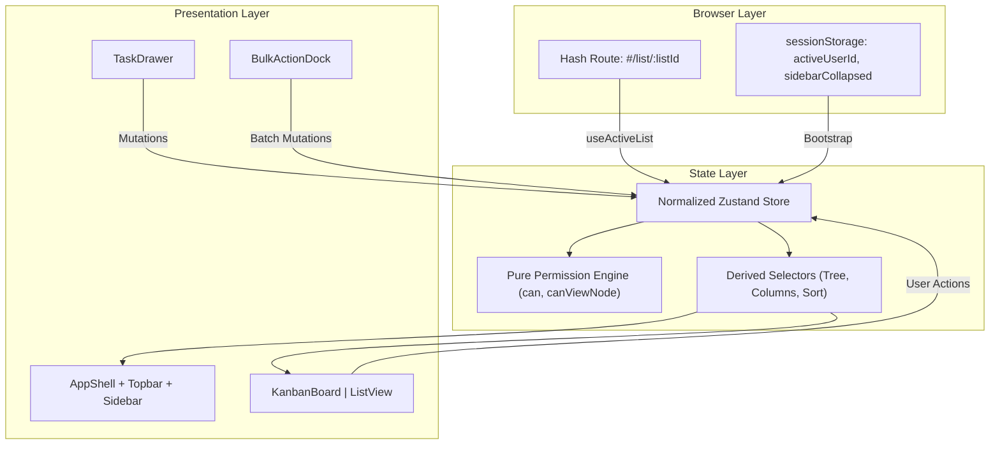

# Architecture & Technical Decisions

This document details the architectural boundaries, state models, data flows, and security decisions implemented in Flowboard.

---

## 1. High-Level Architecture Diagram



---

## 2. Component and Module Boundaries

The codebase enforces strict separation of concerns:

* `src/domain/`: Pure domain types, constants, and permission calculation. Contains zero React or Zustand imports. Can run in any JavaScript runtime.
* `src/store/`: Central state store, fixture seed data, and derived selectors. Manages all atomic state transitions.
* `src/hooks/`: Headless business logic adapters (`useActiveList`, `useDrawer`, `useBulkSelection`, `useSimulatedLoad`).
* `src/components/`: Pure presentation layer. Divided by domain (`app`, `board`, `list`, `drawer`, `sidebar`, `shared`).

---

## 3. Store Architecture and State Ownership

Flowboard uses a single normalized Zustand store (`src/store/store.ts`). Relational data is structured as flat key-value dictionaries rather than nested trees:

```typescript
interface AppStoreState {
  // Normalized Entities
  containersById: Record<string, ContainerNode>;
  statusesById: Record<string, TaskStatus>;
  tasksById: Record<string, Task>;
  usersById: Record<string, User>;
  grants: Grant[];
  nextTaskNumber: number;

  // Session State
  activeUserId: string;
  viewMode: 'board' | 'list';
  taskMutationInFlight: boolean;
  simulateFailureNext: boolean;
}
```

### Why a Normalized Dictionary?
1. **O(1) Updates**: Updating a task title or status only touches `tasksById[id]`, preventing full tree traversals.
2. **Referential Integrity**: Containers and statuses exist independently of tasks, matching relational database designs.
3. **Selector Efficiency**: Memoized selectors derive nested trees and sorted columns only when underlying dictionaries change.

---

## 4. Container Hierarchy and Data Modeling

Containers form a strict 4-level tree:

```
Workspace (Root)
└── Space
    ├── Folder
    │   └── List
    └── List
```

### Invariants Enforced at Store Boundary:
* A List can only be created under a Space or Folder.
* A Folder can only be created under a Space.
* A Space can only be created under a Workspace.
* Moving a container validates that the new parent is not a descendant of the moved container, preventing tree cycles.

---

## 5. Task and Status Workflow Modeling

Each List defines its own independent status sequence:

* `TaskStatus.listId` strictly binds every status to its parent List.
* Tasks store `primaryListId` and `statusId`. Moving a task across lists requires re-mapping its status to a valid status in the target list.
* Within a column, tasks use integer positions (`0, 1, 2, ...`). The store contiguously re-indexes sibling positions after every drop or reorder to prevent index drift.

---

## 6. Derived Selector Strategy

Components never inspect raw dictionary structures directly. They subscribe to derived state through pure selectors (`src/store/selectors.ts`):

* `getFilteredTree(state)`: Traverses the container tree, pruning containers hidden by role capabilities, missing allow grants, explicit deny grants, or archived flags.
* `getKanbanColumns(state, listId)`: Groups tasks belonging to `listId` by their list status, ordered by integer position.
* `getSortedTasks(state, listId, sortKey, sortDir)`: Sorts tasks for the Dense List view by priority or due date while preserving deterministic tie-breaking by id.

---

## 7. Permission Enforcement Architecture

Security rules are codified as a pure function engine in `src/domain/permissions.ts`.

### Capability-Based Model
Roles (`admin`, `member`) map to capability sets (`task.create`, `task.move`, `container.create`, etc.). Roles support single inheritance: `admin` inherits all `member` capabilities plus administrative privileges.

### Visibility vs Mutation Rules:
1. **Visibility (Read)**:
   * Admins see all non-archived containers.
   * Members see public containers unless blocked by an explicit `deny` grant.
   * Private containers require an explicit `allow` grant.
   * `Deny` grants win unconditionally over `allow` grants at any ancestor level.
2. **Mutation (Write)**:
   * Creating a task requires `task.create` on the target list.
   * Editing or deleting a task requires `task.edit` or `task.delete`.
   * Moving a task across lists requires symmetric write access: `task.move` on both the source and target list.

All store mutation actions execute capability checks before changing state. If a check fails, the action terminates and returns a typed error (`Result<T, AppError>`), leaving state unmodified.

---

## 8. Persistence Strategy

* **Canonical Domain Data**: Stored strictly in Zustand memory. On page refresh, containers, tasks, statuses, and grants re-seed cleanly from fixtures. This prevents evaluator sessions from becoming polluted with broken test data.
* **Session Perspective (`activeUserId`)**: Persisted in `sessionStorage` under `flowboard.activeUserId`. On hard reload, the user identity is restored synchronously before the first React render.
* **Sidebar Layout (`sidebarCollapsed`)**: Persisted in `sessionStorage` under `flowboard.sidebarCollapsed`. Synchronously read on initial mount to eliminate layout shifts or sidebar popping.

---

## 9. Drag-and-Drop and Optimistic Rollback Strategy

Kanban board interactions use `@dnd-kit/core` with hardware-accelerated transforms.

### Optimistic Mutation Flow:
1. User drops a card into a new column.
2. Store captures a `TaskMoveTransactionSnapshot` containing pre-mutation status, position, and sibling slices.
3. UI applies the drop optimistically and sets `taskMutationInFlight = true`.
4. Store simulates network roundtrip latency (300ms).
5. If `simulateFailureNext` is armed:
   * Store reverts the task and affected siblings back to their snapshot positions.
   * Toast notification alerts the user: *"Couldn't move task. Changes were reverted safely."*
6. A `finally` block guarantees `taskMutationInFlight = false` releases the lock.

### Concurrency Lock
While `taskMutationInFlight` is true, the User Switcher in the Topbar is physically disabled (`disabled={true}`, `opacity-60`). The store action `setActiveUser` rejects calls with `INVARIANT_VIOLATION` to guarantee that transactions cannot commit or roll back under a mismatched user context.

---

## 10. Bulk Update Strategy

Dense List multi-selection uses `useBulkSelection.ts`:
* Stores selected task IDs in a transient React `Set<string>`.
* Auto-clears whenever the user switches lists or user identities.
* When changing status in bulk, `ListView.tsx` extracts task IDs in the exact rendered row order.
* The store action `bulkUpdateTasks` executes all-or-nothing preflight verification across all selected tasks before writing any changes, and appends them sequentially to preserve the visual order.

---

## 11. Architectural Trade-offs

| Decision | Chosen Solution | Trade-off Accepted |
|---|---|---|
| State Storage | In-memory with sessionStorage identity | Data edits reset on refresh, but guarantees deterministic demo states. |
| Permission Layer | Pure functional policy engine | Requires passing context explicitly, but enables 100% testable rules decoupled from UI. |
| Styling Architecture | Tailwind CSS utility classes | Inline styles rejected, except for dynamic drag coordinates in `@dnd-kit`. |
| Concurrency Handling | Exclusive lock during optimistic flight | Multiple simultaneous drags blocked for 300ms, but eliminates race conditions and permission desync. |

---

## 12. Future Permission Evolution

Beyond this take-home scope, the architecture can evolve by:
1. Supporting custom role definitions dynamically created at runtime.
2. Introducing resource-scoped grants at the folder level with inheritance overrides.
3. Adding team-based group grants in addition to user-specific grants.
